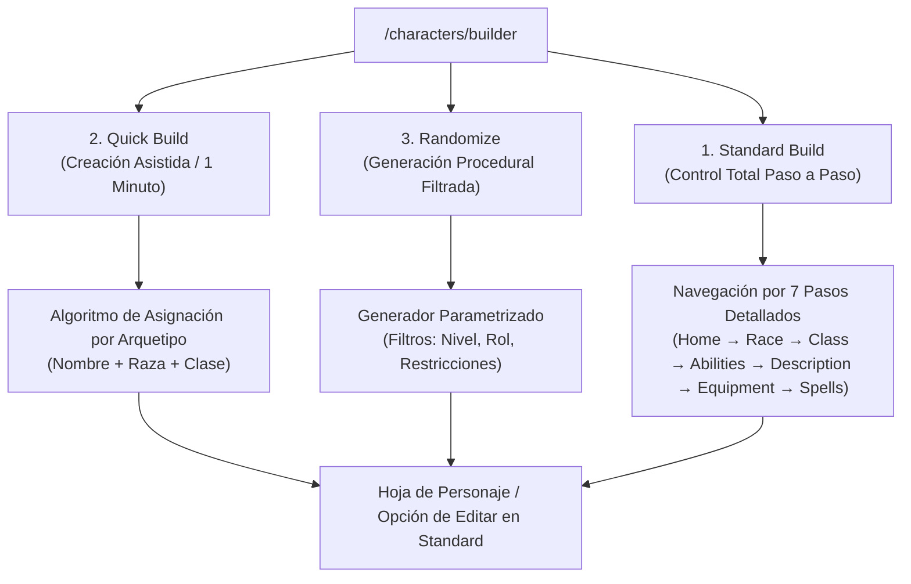
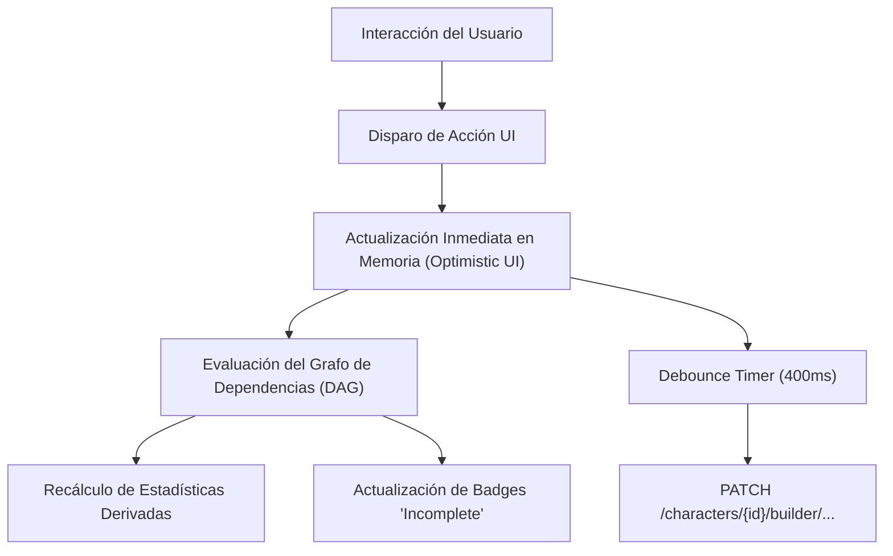

# Arquitectura y Diseño Técnico del Creador de Personajes D&D 5e
### Especificación Técnica de Arquitectura e Implementación

---

## 1. Visión General y Propósito

El creador de personajes de **D&D Beyond** (`https://www.dndbeyond.com/characters/builder`) es uno de los sistemas de creación y gestión de reglas de juego de rol más avanzados de la web. Lejos de ser un simple formulario secuencial de registro, implementa:

1. **Una Máquina de Estados Finita (FSM)** que gobierna la validez y avance del personaje.
2. **Un Grafo Dirigido Acíclico (DAG)** de dependencias reactivas donde cada decisión (Especie, Clase, Dote, Objeto) dispara una cascada de recálculos matemáticos y desbloqueo de opciones.
3. **Un Motor de Modificadores Desacoplado (*Modifier Pipeline*)**, que permite que cientos de fuentes de reglas independientes (manuales oficiales 2014/2024, suplementos de Tasha/Xanathar, homebrew) alteren estadísticas sin colisionar ni sobreescribir datos base.

Este documento desglosa en profundidad:
- Los **3 modos de creación** accesibles en la raíz (`/characters/builder`).
- Las **7 fases detalladas del constructor estándar** (`/builder/home/basic` a `/spells`).
- La arquitectura de **Frontend (React/SPA)** y **Backend (Character Service & Rules Engine)**.
- La **guía de implementación en Flutter**, adaptada al proyecto local de visualizador y a los compendios **OKF (Open Knowledge Format)** disponibles en este repositorio.

---

## 2. Los Tres Métodos de Creación (`/characters/builder`)

Al acceder a la pantalla inicial de creación, el usuario se encuentra con tres modalidades claramente diferenciadas según el nivel de experiencia y tiempo disponible:



---

### 2.1. Standard Build (Creación Manual Paso a Paso)
- **Audiencia**: Jugadores experimentados o que crean un personaje para una campaña de larga duración.
- **Funcionamiento**: Permite tomar todas y cada una de las micro-decisiones: selección de reglas opcionales, activación/desactivación de homebrew, compra de características por puntos, elección de dotes, estilos de combate, idiomas, conjuros y equipo pieza por pieza.
- **Ventaja**: Garantiza control milimétrico sobre cada rasgo y personalización matemática.

---

### 2.2. Quick Build (Creación Rápida Asistida)
- **Audiencia**: Principiantes, jugadores de sesiones one-shot o Dungeon Masters que necesitan un personaje jugable en menos de 60 segundos.
- **Mecánica de Entrada**:
  - Solicita únicamente 3 datos: **Nombre del Personaje**, **Raza/Especie** y **Clase**.
- **Algoritmo de Resolución Automática**:
  1. **Asignación de Características (Priority Array)**: Cada clase tiene definida una jerarquía de prioridades sobre el *Standard Array* (15, 14, 13, 12, 10, 8):
     - *Mago*: INT (15), CON (14), DEX (13), WIS (12), CHA (10), STR (8).
     - *Bárbaro*: STR (15), CON (14), DEX (13), WIS (12), CHA (10), INT (8).
     - *Pícaro*: DEX (15), CON (14), INT (13), WIS (12), CHA (10), STR (8).
  2. **Competencias Automáticas**: Selecciona las habilidades más emblemáticas de la clase (ej. Sigilo y Juego de Manos para Pícaro; Atletismo y Supervivencia para Bárbaro).
  3. **Paquete de Equipamiento Estándar**: Otorga el kit inicial por defecto sin pedir elecciones alternativas.
  4. **Conjuros Sugeridos**: Si es lanzador de conjuros, asigna automáticamente los trucos y conjuros de nivel 1 esenciales (ej. *Rayo de Fuego*, *Manos Ardientes* y *Armadura de Mago*).
- **Post-proceso**: El personaje generado puede abrirse inmediatamente en la hoja de personaje o editarse en cualquier momento usando el modo Standard para modificar detalles.

---

### 2.3. Randomize (Generador Aleatorio Parametrizado)
- **Audiencia**: Jugadores indecisos, desafíos de rol o creación instantánea de PNJs (NPCs) complejos para el DM.
- **Parámetros de Control (Filtros Opcionales)**:
  - **Selector de Nivel**: De nivel 1 a 20.
  - **Bloqueo / Filtro de Clase**: Permite dejarlo 100% aleatorio o forzar un arquetipo (ej. "Cualquier lanzador divino", o fijar "Paladín").
  - **Bloqueo / Filtro de Especie**: Permite fijar o excluir linajes específicos.
  - **Bloqueo de Trasfondo o Alineamiento**.
- **Motor Procedural Coherente**:
  - No genera combinaciones rotas: si asigna nivel 5 a un lanzador de conjuros, calcula los espacios de nivel 3 correspondientes y selecciona conjuros legales para ese nivel.
  - Genera aleatoriamente nombre, rasgos de personalidad, ideales, vínculos, defectos e historia inicial.
  - Incluye botón **"Re-roll" (Tirar de nuevo)** para regenerar al instante con los mismos filtros.

---

## 3. Desglose Exhaustivo de las 7 Fases del Constructor Estándar

A continuación se detalla la anatomía de cada una de las 7 pestañas que componen la ruta `/characters/{id}/builder/...`.

```
/characters/{id}/builder/
├── 1. home/basic         --> Configuración de reglas, fuentes y preferencias
├── 2. race               --> Selección de Especie, linaje y rasgos innatos
├── 3. class              --> Clases, subclases, niveles, multiclase y opciones
├── 4. abilities          --> Generación de atributos (Standard, Point Buy, Manual)
├── 5. description        --> Trasfondo, alineamiento, físico y notas
├── 6. equipment          --> Inventario, oro inicial, armaduras y sintonización
└── 7. spells             --> Trucos, conjuros conocidos/preparados y espacios
```

---

### Fase 1: Home (`/builder/home/basic`) - Reglas y Fuentes

Es la raíz de configuración que define los filtros del catálogo y el comportamiento del motor de reglas para ese personaje.

#### Features y Opciones Configurables:
1. **Interruptores de Fuentes de Contenido (*Source Toggles*)**:
   - *Manual del Jugador 2024 / 2014*: Alternar entre las reglas nuevas y las heredadas (*Legacy*).
   - *Opciones de Personalización de Tasha*: Permite desacoplar los incrementos de característica (+2/+1) de la raza para asignarlos libremente.
   - *Contenido Oficial vs No Oficial*: Interruptores para activar/desactivar *Homebrew*, *Critical Role Content*, *Magic: The Gathering (MtG)*, *Eberron*, *Rick & Morty*.
2. **Método de Avance (*Advancement Type*)**:
   - *Por Hitos (Milestone)*: El nivel se incrementa manualmente sin contar puntos.
   - *Por Puntos de Experiencia (XP)*: Muestra un contador numérico de PX que desbloquea niveles al alcanzar umbrales oficiales (300, 900, 2700...).
3. **Tipo de Puntos de Golpe (*Hit Point Type*)**:
   - *Fijo (Fixed / Average)*: Calcula automáticamente el valor medio redondeado hacia arriba en cada subida de nivel (ej. d8 $\rightarrow$ 5 + mod CON).
   - *Manual*: Despliega casillas numéricas para ingresar la tirada física de dados nivel por nivel.
4. **Requisitos de Dotes y Multiclase (*Prerequisites Toggles*)**:
   - Permite desactivar las restricciones oficiales (ej. el requisito de tener 13 en Fuerza para multiclasear a Paladín).
5. **Carga y Monedas**:
   - Activar regla de peso de monedas (50 monedas = 1 libra).
   - Tipo de regla de carga: Desactivada, Estándar ($15 \times \text{STR}$), o Variante de Carga (*Encumbrance Variant* con penalizaciones a la velocidad a $5 \times \text{STR}$).
6. **Visibilidad del Personaje**:
   - Pública (accesible por URL), Privada (solo el propietario) o Compartida en Campaña (el DM puede ver y editar).

---

### Fase 2: Race / Species (`/builder/race`) - Especie y Linajes

Establece la base biológica/ancestral del personaje.

#### Features e Interacciones:
1. **Catálogo con Filtros**: Listado visual de especies con selector de subespecie (ej. *Elfo* $\rightarrow$ *Alto Elfo*, *Elfo de los Bosques*, *Drow*).
2. **Decisiones Dinámicas Anidadas (*Choice Pickers*)**:
   - Si una especie dice *"Elige 2 idiomas"* o *"Elige 1 habilidad entre 4 opciones"*, la UI despliega desplegables dinámicos con validación de exclusión mutua (no se puede elegir la misma dos veces).
3. **Reglas de Incremento de Atributos**:
   - *Regla Clásica (2014)*: +2 Des / +1 Sab fijos.
   - *Regla Moderna (Tasha / 2024)*: Despliega selectores para asignar libremente `+2 / +1` o `+1 / +1 / +1`.
4. **Rasgos Innatos Registrados**:
   - *Visión en la Oscuridad (Darkvision)*: Registra un modificador de sentido pasivo de 60 o 120 pies.
   - *Velocidad Base*: Modificador `set: speed = 30`.
   - *Conjuros Raciales*: Otorga trucos innatos que usan un atributo específico (ej. Carisma para *Tiefling*).

---

### Fase 3: Class (`/builder/class`) - Progresión de Clase y Multiclase

Es el módulo más complejo del sistema, controlando la identidad de combate y magia.

#### Features e Interacciones:
1. **Selector de Nivel Global y por Clase**:
   - Permite subir de nivel 1 a 20 mediante un selector numérico.
   - Soporte nativo para **Multiclase**: Botón `+ Add Another Class`. Cada clase individual tiene su propio selector de nivel, sumando el nivel total del personaje.
2. **Subclases Dinámicas (Arquetipos)**:
   - Se desbloquea automáticamente en el nivel reglamentario (Nivel 1 para Clérigo/Brujo; Nivel 3 para Guerrero/Pícaro/Mago).
3. **Árbol de Elecciones de Clase (*Feature Choices*)**:
   - Estilo de Combate (*Fighting Style*): Arquero, Defensa, Duelista, etc.
   - Pactos e Invocaciones del Brujo (*Eldritch Invocations*): Filtra por nivel de brujo y prerequisito de pacto.
   - Metamagia del Hechicero (*Metamagic*).
   - Mejoras de Característica o Dote (*ASI or Feat*): En niveles 4, 8, 12, 16 y 19, despliega la opción de elegir entre +2 a un atributo, +1 a dos atributos, o seleccionar una Dote del catálogo.
4. **Validación de Multiclase en Tiempo Real**:
   - Si el personaje no cumple los atributos requeridos (ej. Carisma 13 y Fuerza 13 para Paladín) y la regla de prerrequisitos está activa, el botón de añadir clase aparece bloqueado con una advertencia explicativa.

---

### Fase 4: Abilities (`/builder/abilities`) - Atributos

Calcula las 6 puntuaciones básicas: Fuerza (STR), Destreza (DEX), Constitución (CON), Inteligencia (INT), Sabiduría (WIS) y Carisma (CHA).

#### Los Tres Métodos Disponibles:
1. **Standard Array**:
   - Presenta los valores fijos `[15, 14, 13, 12, 10, 8]` para asignarlos a cada una de las 6 características mediante dropdowns que deshabilitan los valores ya usados.
2. **Point Buy (Compra por Puntos)**:
   - Presupuesto inicial: **27 puntos**.
   - Cada atributo inicia en 8. Rango permitido: de 8 a 15.
   - **Coste no lineal**:
     - 8 $\rightarrow$ 0 pts | 9 $\rightarrow$ 1 pt | 10 $\rightarrow$ 2 pts | 11 $\rightarrow$ 3 pts | 12 $\rightarrow$ 4 pts | 13 $\rightarrow$ 5 pts | 14 $\rightarrow$ 7 pts | 15 $\rightarrow$ 9 pts.
   - Contador visual en vivo que descuenta el presupuesto disponible e impide compras ilegales.
3. **Manual / Rolled**:
   - Permite ingresar números libremente (para quienes tiraron dados en mesa) o incluye un simulador de tiradas `4d6 drop lowest` que genera las 6 cifras y permite arrastrarlas a cada casilla.

#### Matriz de Cálculo Transparente:
La UI muestra una tabla desglosada por columnas:
$$\text{Base} + \text{Racial} + \text{Dotes/ASI} + \text{Misceláneo} = \mathbf{\text{Puntuación Total}} \longrightarrow \mathbf{\text{Modificador}}$$
Donde el modificador se calcula como:
$$\text{Mod} = \left\lfloor \frac{\text{Score} - 10}{2} \right\rfloor$$

---

### Fase 5: Description (`/builder/description`) - Trasfondo y Narrativa

Conecta las reglas con la identidad del personaje.

#### Features e Interacciones:
1. **Selector de Trasfondo (*Background*)**:
   - Otorga 2 competencias en habilidades fijas o a elegir.
   - Otorga competencias en herramientas o idiomas.
   - En las reglas 2024, otorga una **Dote de Origen (*Origin Feat*)** obligatoria (ej. *Alerta*, *Afortunado*, *Iniciado en la Magia*).
2. **Tablas de Personalidad**:
   - Rasgos de personalidad, ideales, vínculos y defectos (permite escribir texto libre o hacer clic en *"Roll on Table"* para obtener uno de las tablas oficiales).
3. **Detalles Físicos y Religiosos**:
   - Edad, altura, peso, ojos, piel, pelo, deidad, alineamiento y estilo de vida (*Lifestyle expenses*).
4. **Caja de Historia y Notas Privadas**:
   - Editor de texto enriquecido para backstory y notas del jugador.

---

### Fase 6: Equipment (`/builder/equipment`) - Inventario y Riqueza

Gestiona el arsenal, consumibles y economía inicial.

#### Features e Interacciones:
1. **Elección de Inicio**:
   - **Equipamiento de Clase + Trasfondo**: Otorga paquetes preconfigurados con elecciones directas (ej. *"¿Espada corta o maza?"*, *"¿Arco largo con 20 flechas o ballesta ligera?"*).
   - **Oro Inicial (*Starting Gold*)**: Calcula el dinero inicial promedio de la clase (o permite tirarlo en dados) para adquirir equipo a la carta en la tienda virtual.
2. **Gestión de Inventario en Tiempo Real**:
   - Botón `Add Item`: Buscador de base de datos de armas, armaduras, pociones y objetos mágicos.
   - **Estados de Ítems**:
     - *Equipped*: Activa el cálculo de Clase de Armadura (CA) o ataques en la ficha.
     - *Carried*: Suma al peso total transportado.
     - *Attuned (Sintonizado)*: Casillas de 1 a 3 para objetos mágicos que requieren sintonización.
3. **Calculadora de Carga y Monedero**:
   - Conversión y almacenamiento de Cobre (CP), Plata (SP), Electro (EP), Oro (GP) y Platino (PP).
   - Barra de peso total comparada contra el límite de capacidad de carga ($15 \times \text{STR}$).

---

### Fase 7: Spells (`/builder/spells`) - Magia y Conjuros

Aparece únicamente si el personaje tiene niveles en una clase con rasgo de lanzamiento de conjuros (*Spellcasting* o *Pact Magic*).

#### Features e Interacciones:
1. **Gestión según Mecánica de Lanzamiento**:
   - *Lanzadores de Conjuros Conocidos* (Bardo, Hechicero, Brujo): El constructor muestra un límite estricto de conjuros que el personaje puede tener en su repertorio.
   - *Lanzadores de Conjuros Preparados* (Clérigo, Druida, Paladín): Tienen acceso a toda la lista de clase y eligen diariamente una cantidad igual a $\text{Nivel} + \text{Modificador de Lanzamiento}$.
   - *Mago (Libro de Conjuros)*: Gestiona los conjuros anotados en el Grimorio y una sub-selección de cuáles están preparados para el día.
2. **Filtros Avanzados en el Selector**:
   - Filtrado por nivel de conjuro (Truco a Nivel 9).
   - Filtro por escuela de magia (Evocación, Nigromancia, etc.).
   - Filtro por componentes (Verbal, Somático, Material / Sin coste en oro).
   - Filtro por concentración y ritual.
3. **Métricas de Lanzamiento Calculadas en Vivo**:
   - **CD de Salvación de Conjuros**: $8 + \text{Bono de Competencia} + \text{Modificador Clave}$.
   - **Bonificador de Ataque Mágico**: $\text{Bono de Competencia} + \text{Modificador Clave}$.
   - **Rastreador de Espacios de Conjuro (*Spell Slots*)**: Tabla de casillas por nivel de conjuro.

---

## 4. Arquitectura Frontend: Patrones de Interacción y UX

El frontend de D&D Beyond está estructurado como una Single Page Application (SPA) en React con las siguientes características técnicas clave:



### 4.1. Patrones de Diseño de Componentes
1. **Drawer / Slide-over Modal (Detalle sin Pérdida de Contexto)**:
   - Al explorar cualquier raza, clase, dote o conjuro, nunca se redirige a otra página. Se abre un panel lateral deslizante (*Side Drawer*) con el texto íntegro del compendio, requisitos y botón de selección.
2. **Incomplete Action Badges (Guiado Activo)**:
   - Cada pestaña y cada bloque dentro del paso muestra un distintivo visual (ej. `! 2 Choices Remaining`). Si el jugador no elige sus habilidades de clase o sus trucos de mago, el badge permanece visible para garantizar que la ficha esté completa.
3. **Barra Superior de Identidad Flotante (*Builder Header*)**:
   - Muestra permanentemente el Avatar, Nombre, Raza, Nivel, Clase actual y Puntos de Golpe totales, actualizándose al segundo con cualquier cambio.
4. **Sincronización en Segundo Plano con Debounce**:
   - Los campos de texto libre (Nombre, Notas, Historia) y los selectores numéricos no bloquean la UI con peticiones síncronas. Actualizan el estado local de inmediato y lanzan una llamada `PATCH` con un retraso (*debounce*) de 400 ms.

---

## 5. Arquitectura Backend y Modelo de Modificadores

El backend expone servicios REST/GraphQL respaldados por un **Motor de Modificadores** determinista.

### 5.1. El Pipeline de Modificadores (*Modifier Pipeline*)

En lugar de almacenar valores estáticos finales en la base de datos (lo que provocaría inconsistencias si cambia una regla), el backend almacena **la intención de cada regla como un modificador atómico**:

```json
{
  "id": "mod_1048",
  "type": "bonus",
  "subType": "dexterity-score",
  "value": 2,
  "sourceType": "species",
  "sourceId": 1
}
```

#### Tipos de Operaciones de Modificador:
- `bonus`: Suma un número entero a una característica, CA, tirada de ataque o daño.
- `set`: Fuerza un valor mínimo absoluto (ej. *Diadema de Intelecto* establece Inteligencia en 19).
- `proficiency`: Otorga competencia (añade Bono de Competencia a salvaciones o habilidades).
- `half-proficiency`: Otorga media competencia redondeada hacia abajo (ej. *Jack of All Trades* del Bardo).
- `expertise`: Otorga pericia (añade el doble del Bono de Competencia).
- `advantage` / `disadvantage`: Registra ventaja circunstancial en tiradas (ej. salvaciones contra veneno de los Enanos).
- `sense`: Añade visión en la oscuridad o visión ciega con un rango numérico.

#### Orden Estricto de Evaluación:
```
1. Base Value (Puntuación de compra / regla base)
2. Reglas 'Set' (Sobreescrituras fijas si superan al base)
3. Modificadores 'Bonus' (Raza + Trasfondo + Clase + Dotes + Magia)
4. Modificadores de Competencia (Proficiency / Expertise / Half-Proficiency)
5. Modificadores Condicionales (Ventaja / Desventaja / Restricciones)
```

---

## 6. Guía de Implementación para Flutter (Desktop & Mobile)

Dado que este repositorio (`Vizualizador Dnd`) ya cuenta con la base de datos atómica **OKF** (495 entidades de Manual 2024, Tasha y Xanathar) y un visor de escritorio en Flet/Python, esta sección detalla cómo implementar el Creador de Personajes en **Flutter nativo** o extender la suite actual.

### 6.1. Arquitectura de Código Propuesta (Clean Architecture + Riverpod)

```
lib/
├── core/
│   ├── engine/
│   │   ├── modifier_pipeline.dart    <-- Motor de cálculo de modificadores
│   │   ├── point_buy_calculator.dart <-- Calculadora matemática de 27 pts
│   │   └── multiclass_resolver.dart  <-- Tablas de espacios de conjuros combinadas
│   └── okf_parser/                   <-- Lector de compendios Markdown + YAML
├── features/
│   ├── character_builder/
│   │   ├── domain/
│   │   │   ├── entities/             <-- Character, ClassEntity, Modifier, Spell
│   │   │   └── state/
│   │   │       └── builder_state.dart
│   │   ├── data/
│   │   │   ├── repositories/         <-- Carga local JSON/OKF y exportación PDF
│   │   │   └── models/
│   │   └── presentation/
│   │       ├── screens/
│   │       │   ├── builder_hub_screen.dart   <-- Pantalla con los 3 modos
│   │       │   └── standard_builder_screen.dart <-- Stepper de las 7 fases
│   │       └── widgets/
│   │           ├── step_stepper_bar.dart
│   │           ├── ability_score_matrix.dart
│   │           └── okf_selection_drawer.dart <-- Modal lateral de detalle
```

---

### 6.2. Motor de Cálculo en Dart (`modifier_pipeline.dart`)

```dart
enum ModifierType { bonus, set, proficiency, expertise, halfProficiency }

class CharacterModifier {
  final String id;
  final ModifierType type;
  final String targetStat; // ej. 'strength-score', 'armor-class', 'stealth'
  final int? value;
  final String source;

  const CharacterModifier({
    required this.id,
    required this.type,
    required this.targetStat,
    this.value,
    required this.source,
  });
}

class ModifierPipeline {
  /// Calcula el valor total de una característica considerando Base, Sets y Bonos
  static int evaluateAbilityScore({
    required String abilityName,
    required int baseScore,
    required List<CharacterModifier> modifiers,
  }) {
    final relevant = modifiers.where((m) => m.targetStat == '$abilityName-score');

    // 1. Verificar si existe un modificador 'set' que supere el base
    final sets = relevant.where((m) => m.type == ModifierType.set);
    int current = baseScore;
    if (sets.isNotEmpty) {
      final highestSet = sets.map((m) => m.value ?? 0).reduce((a, b) => a > b ? a : b);
      if (highestSet > current) current = highestSet;
    }

    // 2. Sumar todos los bonos
    final bonuses = relevant
        .where((m) => m.type == ModifierType.bonus)
        .fold<int>(0, (sum, m) => sum + (m.value ?? 0));

    return current + bonuses;
  }

  /// Calcula el modificador numérico estándar de D&D: floor((Score - 10) / 2)
  static int getModifier(int score) => ((score - 10) / 2).floor();

  /// Calcula el Bono de Competencia oficial por nivel
  static int getProficiencyBonus(int totalLevel) => ((totalLevel - 1) / 4).floor() + 2;

  /// Calcula el valor final de una tirada de habilidad
  static int evaluateSkillModifier({
    required String skillName,
    required String governingAbility,
    required int abilityScore,
    required int totalLevel,
    required List<CharacterModifier> modifiers,
  }) {
    final abilityMod = getModifier(abilityScore);
    final pb = getProficiencyBonus(totalLevel);
    final skillMods = modifiers.where((m) => m.targetStat == skillName);

    if (skillMods.any((m) => m.type == ModifierType.expertise)) {
      return abilityMod + (2 * pb);
    } else if (skillMods.any((m) => m.type == ModifierType.proficiency)) {
      return abilityMod + pb;
    } else if (modifiers.any((m) => m.targetStat == 'all-skills' && m.type == ModifierType.halfProficiency)) {
      return abilityMod + (pb ~/ 2);
    }
    return abilityMod;
  }
}
```

---

### 6.3. Calculadora de Point Buy en Dart (`point_buy_calculator.dart`)

```dart
class PointBuyCalculator {
  static const int totalBudget = 27;
  static const int minScore = 8;
  static const int maxScore = 15;

  static const Map<int, int> pointCostTable = {
    8: 0,
    9: 1,
    10: 2,
    11: 3,
    12: 4,
    13: 5,
    14: 7,
    15: 9,
  };

  static int calculateUsedPoints(Map<String, int> scores) {
    return scores.values.fold(0, (sum, score) {
      return sum + (pointCostTable[score] ?? 0);
    });
  }

  static int getRemainingPoints(Map<String, int> scores) {
    return totalBudget - calculateUsedPoints(scores);
  }

  static bool canIncrement(Map<String, int> scores, String ability) {
    final current = scores[ability] ?? minScore;
    if (current >= maxScore) return false;
    final costDiff = (pointCostTable[current + 1] ?? 99) - (pointCostTable[current] ?? 0);
    return getRemainingPoints(scores) >= costDiff;
  }

  static bool canDecrement(Map<String, int> scores, String ability) {
    final current = scores[ability] ?? minScore;
    return current > minScore;
  }
}
```

---

### 6.4. Generador Aleatorio Procedural (`random_character_generator.dart`)

```dart
import 'dart:math';

class RandomCharacterGenerator {
  static final _random = Random();

  /// Genera 6 atributos usando la regla clásica 4d6 drop lowest
  static List<int> rollAbilities() {
    return List.generate(6, (_) {
      final rolls = List.generate(4, (_) => _random.nextInt(6) + 1)..sort();
      return rolls.sublist(1).reduce((a, b) => a + b); // Suma los 3 más altos
    });
  }

  /// Asigna los valores tirados en orden de prioridad según la clase
  static Map<String, int> assignClassPriorities(String className, List<int> rolledScores) {
    final sorted = List<int>.from(rolledScores)..sort((a, b) => b.compareTo(a)); // Descendente
    final priorities = _getClassPriority(className);

    final result = <String, int>{};
    for (int i = 0; i < priorities.length; i++) {
      result[priorities[i]] = sorted[i];
    }
    return result;
  }

  static List<String> _getClassPriority(String className) {
    switch (className.toLowerCase()) {
      case 'wizard':
        return ['intelligence', 'constitution', 'dexterity', 'wisdom', 'charisma', 'strength'];
      case 'fighter':
      case 'barbarian':
        return ['strength', 'constitution', 'dexterity', 'wisdom', 'charisma', 'intelligence'];
      case 'rogue':
        return ['dexterity', 'constitution', 'intelligence', 'wisdom', 'charisma', 'strength'];
      case 'cleric':
        return ['wisdom', 'constitution', 'strength', 'intelligence', 'charisma', 'dexterity'];
      default:
        return ['dexterity', 'constitution', 'strength', 'wisdom', 'charisma', 'intelligence'];
    }
  }
}
```

---

## 7. Hoja de Ruta para Integración en el Proyecto Local

Para trasladar este diseño a tu aplicación en `Vizualizador Dnd`:

| Hito | Componente a Implementar | Dependencia en Repositorio |
| :--- | :--- | :--- |
| **Hito 1** | **Hub de Creación (`/builder`)** | Pantalla principal con tarjetas: *Standard*, *Quick Build* y *Randomize*. |
| **Hito 2** | **Motor de Modificadores en Python/Dart** | Lógica de cálculo en `okf_dnd5e/` o `lib/core/engine/` siguiendo el modelo desacoplado. |
| **Hito 3** | **Calculadora Point Buy & Array** | Widget visual de selección con matriz de cálculo en tiempo real. |
| **Hito 4** | **Conexión con Compendios OKF** | El `SideDrawer` debe leer directamente los archivos `.md` de `okf_dnd5e/` (Especies, Clases, Dotes y Conjuros). |
| **Hito 5** | **Exportación a PDF Oficial AcroForm** | Conectar el estado final del creador con el rellenador de PDF existente (`Artanis LVL 4.pdf` / `Manual del Jugador 2024.pdf`). |
