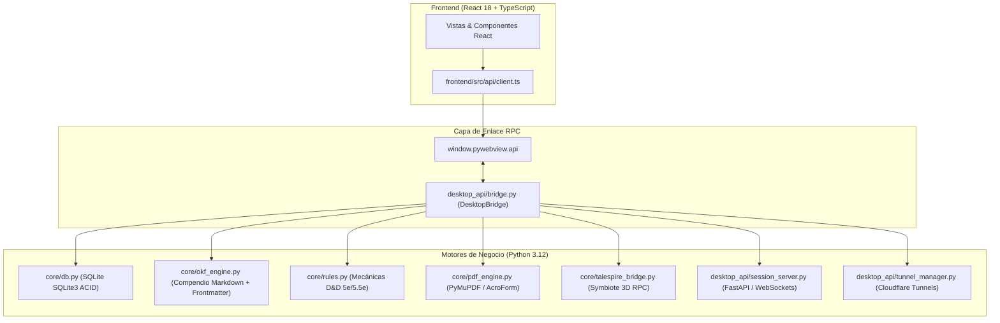

# 🏛️ Parma — Arquitectura del Backend

Este documento detalla la arquitectura de backend de **Parma (Character Hub & Grimoire)**, sus decisiones de ingeniería, estructura modular, motores de negocio en Python y el historial de problemas técnicos resueltos.

---

## 1. Visión General y Filosofía de Diseño

Parma es una aplicación de escritorio nativa orientada a jugadores y Directores de Juego (DM) de **D&D 5ª Edición (2014) y 5.5ª Edición (2024)**.

### Decisión Fundamental: PyWebView vs. Electron
* **Problema:** Los frameworks como Electron o Tauri con Chromium empaquetan un navegador completo de 150MB+ con alto consumo de memoria RAM en reposo (250MB–400MB).
* **Solución Adoptada:** Se seleccionó **PyWebView** con bindings al motor nativo del sistema operativo:
  * **Windows:** Microsoft Edge WebView2 (`winforms` / evergreen runtime).
  * **Linux:** WebKitGTK 4.1 (`gir1.2-webkit2-4.1`).
* **Resultado:** Ejecutable ligero, consumo de RAM inferior a 70MB y tiempo de arranque menor a 1.2 segundos sin sobrecarga de Chromium.



---

## 2. Componentes Principales del Backend

### A. Capa de Enlace RPC (`desktop_api/bridge.py`)
Expone métodos asíncronos serializados en JSON directamente a la ventana de React mediante introspección de PyWebView:
* **Gestión de Fichas:** `list_characters`, `get_active_character`, `save_character`, `delete_character`.
* **Retratos e IA:** `upload_character_portrait`, `set_character_portrait_base64`, `generate_ai_portrait` (soporte backend para Imagen 3, OpenAI DALL-E y Stable Diffusion sin bloqueos CORS).
* **Grimorio y Conjuros:** `get_class_spells`, `get_available_spells`, `add_spell_to_character`, `remove_spell_from_character`.
* **Descansos y Reglas:** `perform_rest` (corto y largo), `validate_point_buy`, `get_builder_catalog`.
* **Exportación/Importación:** `export_character_pdf`, `import_character_pdf`, `export_character_json`, `import_character_json`.

### B. Base de Datos SQLite (`core/db.py` y `core/models.py`)
* Almacena fichas en `data/characters.db` con esquema relacional y soporte transaccional ACID.
* **Modelos Fuertes (`core/models.py`):**
  * `CharacterSheet`: Hoja completa con atributos, salvaciones, ranuras de conjuros, armas, rasgos y crónicas.
  * `WeaponAction`: Acciones de combate con fórmulas de dados parametrizadas.
  * `SpellItem`: Tarjetas de conjuro con escuelas, componentes, alcance y descripciones bilingües.
  * `CharacterFeature`: Rasgos dinámicos con seguimiento de usos actuales/máximos y tipo de recarga (Corto/Largo).
  * `SessionLog` y `NetworkNode`/`NetworkEdge`: Diario de campaña y grafo social de PNJs/facciones.

### C. Motor de Compendio Atómico OKF (`core/okf_engine.py`)
* Parsea más de 570 tarjetas atómicas en Markdown con YAML frontmatter alojadas en `okf_dnd5e/`.
* Búsqueda difusa y filtros indexados por clase, nivel, tipo de acción, escuela mágica y fuente (PHB 2024, Xanathar, Tasha).
* `SrdImporter` (`core/srd_importer.py`): Regenerador automático del índice maestro JSON a partir de los archivos de texto.

### D. Servidor DM Online y Conectividad (`desktop_api/session_server.py`)
* Servidor asíncrono **FastAPI + Uvicorn** ejecutado en un hilo daemon secundario (`find_free_port(8765)`).
* `ConnectionManager`: Administra websockets activos entre DM, jugadores conectados desde navegador y el cliente TaleSpire.
* `CloudflareTunnelManager`: Levanta túneles seguros temporales sin requerir apertura de puertos en el router del DM (Port Forwarding), generando URLs públicas seguras `https://*.trycloudflare.com` y códigos QR para acceso móvil inmediato.

### E. Puente TaleSpire 3D (`core/talespire_bridge.py` y `talespire_symbiote/`)
* Integración bidireccional con el Virtual Tabletop 3D TaleSpire.
* Detecta directorios oficiales de Steam en Windows y Linux (Proton/Wine).
* Auto-instalación del plugin Symbiote en la carpeta de TaleSpire.
* Soporte de tiradas tridimensionales y comandos de chat interactivos (`!Hechizo:1d20+5`).

### F. Motor de Lectura e Interpretación PDF (`core/pdf_engine.py`)
* Basado en **PyMuPDF (`fitz`)**.
* `PdfReaderEngine`: Renderizado en memoria con liberación de memoria de pixmaps nativos y caché LRU de páginas para no saturar memoria al leer manuales pesados (300+ páginas).
* `UniversalAcroFormHandler`: Mapeo bidireccional de campos AcroForm oficiales (español e inglés), permitiendo rellenar hojas de personaje oficiales de Wizards of the Coast.

---

## 3. Decisiones de Diseño y Problemas Resueltos

### 1. Incompatibilidad Gráfica en Linux (Pantallas Negras / DMABUF)
* **Problema:** En distribuciones Linux modernas (Pop!_OS, Ubuntu 24.04) con Wayland o tarjetas gráficas NVIDIA, WebKitGTK fallaba en la negociación de buffers de video causando cuelgues o pantallas en negro.
* **Solución:** Inyección mandatoria en `desktop_app.py` y `parma.sh`:
  ```python
  if sys.platform.startswith("linux"):
      os.environ.setdefault("WEBKIT_DISABLE_DMABUF_RENDERER", "1")
  ```

### 2. Detección Inteligente de Tema en Barra de Tareas (Windows y Linux)
* **Windows:** Lectura directa del registro en `HKCU\Software\Microsoft\Windows\CurrentVersion\Themes\Personalize` (`SystemUsesLightTheme`) para seleccionar dinámicamente iconos `.ico` de alto contraste (escudo negro en barra clara, escudo blanco en barra oscura).
* **Linux:** Consulta vía `gsettings get org.gnome.desktop.interface color-scheme` y variable `GTK_THEME` para asignar el PNG correspondiente (`parma_taskbar_dark.png` vs `parma_taskbar_light.png`).

### 3. Empaquetado PyInstaller y Hidden Imports
* **Problema:** PyInstaller no detectaba las dependencias dinámicas del servidor FastAPI ni los protocolos de WebSocket durante el análisis estático.
* **Solución:** Inclusión explícita de hidden imports en `build_desktop.py`:
  `--hidden-import=fastapi`, `uvicorn`, `uvicorn.logging`, `uvicorn.loops`, `uvicorn.protocols`, `websockets`, `starlette`, `qrcode`.

### 4. Gestión Centralizada de Rutas y Resiliencia ante UAC (`core/paths.py`)
* **Problema:** Al instalar la aplicación en directorios protegidos de Windows (`C:\Program Files\Parma`), las escrituras en la base de datos SQLite y la descarga de binarios fallaban con `PermissionError: [WinError 5]` o `sqlite3.OperationalError: attempt to write a readonly database`.
* **Solución:** Creación del módulo `core.paths` con dos conceptos clave:
  * **Bundle Dir (Solo Lectura):** Directorio empaquetado por PyInstaller (`sys._MEIPASS` o carpeta del ejecutable) donde residen los recursos estáticos (manuales PDF oficiales, interfaz React compilada y compendio OKF).
  * **User Data Dir (Lectura y Escritura):** Almacenamiento persistente en `%LOCALAPPDATA%\Parma\data` (Windows) y `~/.local/share/parma/data` (Linux) para bases de datos SQLite, retratos subidos, exportaciones y binarios de Cloudflare Tunnels.

### 5. Normalización de Rutas en Compendio OKF (`core/okf_engine.py`)
* **Problema:** En sistemas Windows, los separadores de ruta tipo Unix (`/`) impedían resolver la lectura de archivos atómicos Markdown en el panel de detalle del compendio.
* **Solución:** Normalización con `os.path.normpath` y búsqueda en candidatos de fallback en el directorio del proyecto y el bundle.
