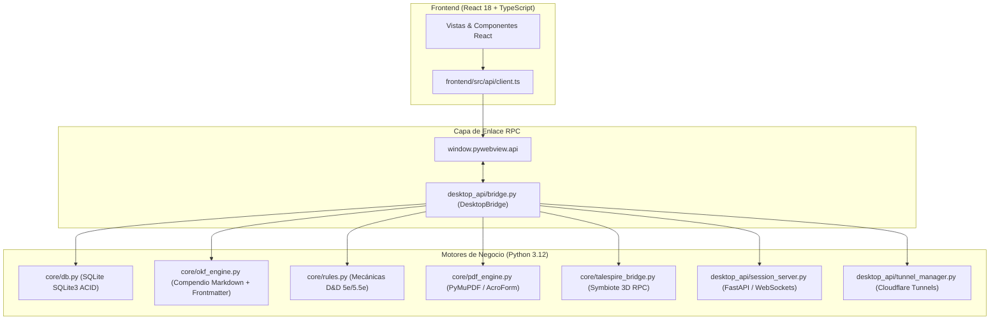

# 🏛️ Parma — Arquitectura del Backend

Este documento detalla la arquitectura de backend de **Parma (Character Hub & Grimoire)**, sus decisiones de ingeniería, estructura modular, motores de negocio en Python y el historial de problemas técnicos resueltos.

> Para el contexto maestro completo del proyecto, catálogo de APIs, ADRs (001–012), requisitos y hoja de ruta, consulta [**`docs/PARMA_MASTER_CONTEXT_AND_ARCHITECTURE.md`**](file:///home/nathanielwrk/Documentos/Proyects/Dnd_Player_Dashboard/docs/PARMA_MASTER_CONTEXT_AND_ARCHITECTURE.md).

---

## 1. Visión General y Filosofía de Diseño

Parma es una aplicación de escritorio nativa orientada a jugadores y Directores de Juego (DM) de **D&D 5ª Edición (2014) y 5.5ª Edición (2024)**.

### Decisión Fundamental: PyWebView vs. Electron
* **Problema:** Los frameworks como Electron o Tauri con Chromium empaquetan un navegador completo de 150MB+ con alto consumo de memoria RAM en reposo (250MB–400MB).
* **Solución Adoptada:** Se seleccionó **PyWebView** con bindings al motor nativo del sistema operativo:
  * **Windows:** Microsoft Edge WebView2 (`winforms` / evergreen runtime).
  * **Linux:** WebKitGTK 4.1 (`gir1.2-webkit2-4.1`).
* **Resultado:** Ejecutable ligero, consumo de RAM inferior a 70MB y tiempo de arranque menor a 1.2 segundos sin sobrecarga de Chromium.



---

## 2. Componentes Principales del Backend

### A. Capa de Enlace RPC (`desktop_api/bridge.py`)
Expone métodos asíncronos serializados en JSON directamente a la ventana de React mediante introspección de PyWebView:
* **Gestión de Fichas:** `list_characters`, `get_active_character`, `save_character`, `delete_character`.
* **Retratos e IA:** `upload_character_portrait`, `set_character_portrait_base64`, `generate_ai_portrait` (soporte backend para Pollinations FLUX gratuito, Imagen 3, OpenAI DALL-E y Stable Diffusion sin bloqueos CORS).
* **Grimorio y Conjuros:** `get_class_spells`, `get_available_spells`, `add_spell_to_character`, `remove_spell_from_character`.
* **Descansos y Reglas:** `perform_rest` (corto y largo), `validate_point_buy`, `get_builder_catalog`.
* **Exportación/Importación:** `export_character_pdf`, `import_character_pdf`, `export_character_json`, `import_character_json`.

### B. Base de Datos SQLite (`core/db.py` y `core/models.py`)
* Almacena fichas en `data/characters.db` con esquema relacional y soporte transaccional ACID en modo WAL (`PRAGMA journal_mode=WAL`).
* **Modelos Fuertes (`core/models.py`):**
  * `CharacterSheet`: Hoja completa con atributos, salvaciones, ranuras de conjuros, armas, rasgos y crónicas.
  * `WeaponAction`: Acciones de combate con fórmulas de dados parametrizadas.
  * `SpellItem`: Tarjetas de conjuro con escuelas, componentes, alcance y descripciones bilingües.
  * `CharacterFeature`: Rasgos dinámicos con seguimiento de usos actuales/máximos y tipo de recarga (Corto/Largo).
  * `SessionLog` y `NetworkNode`/`NetworkEdge`: Diario de campaña y grafo social de PNJs/facciones.

### C. Motor de Compendio Atómico OKF (`core/okf_engine.py`)
* Parsea más de 570 tarjetas atómicas en Markdown con YAML frontmatter alojadas en `okf_dnd5e/`.
* Búsqueda difusa y filtros indexados por clase, nivel, tipo de acción, escuela mágica y fuente (PHB 2024, Xanathar, Tasha).
* `SrdImporter` (`core/srd_importer.py`): Regenerador automático del índice maestro JSON a partir de los archivos de texto.

### D. Servidor DM Online y Conectividad (`desktop_api/session_server.py`)
* Servidor asíncrono **FastAPI + Uvicorn** ejecutado en un hilo daemon secundario (`find_free_port(8765)`), auto-iniciado al arrancar Parma (`ensure_running()`).
* `ConnectionManager`: Administra websockets activos entre DM, jugadores conectados desde navegador/escritorio y el cliente TaleSpire (`/ws/talespire`).
* `CloudflareTunnelManager`: Levanta túneles seguros temporales sin requerir apertura de puertos en el router del DM (Port Forwarding), generando URLs públicas seguras `https://*.trycloudflare.com` y códigos QR para acceso móvil inmediato.

### E. Puente TaleSpire 3D (`core/talespire_bridge.py` y `talespire_symbiote/`)
* Integración bidireccional con el Virtual Tabletop 3D TaleSpire.
* Detecta directorios oficiales de Steam en Windows y Linux (Proton/Wine).
* Auto-instalación del plugin Symbiote en la carpeta de TaleSpire (`ParmaDiceBridge`).
* Soporte de tiradas tridimensionales vía WebSocket (`DICE_ROLL_DISPATCH` / `DICE_ROLL_RESOLVED`), fallback Named Pipe / URI (`talespire://dice/`) y modos duales de lanzamiento (`talespire_auto_throw`).

### F. Motor de Lectura e Interpretación PDF (`core/pdf_engine.py`)
* Basado en la versión moderna de **PyMuPDF (`import pymupdf`)**, eliminando advertencias de obsolescencia de la API legacy `fitz`.
* `PdfReaderEngine`: Renderizado en memoria con liberación de memoria de pixmaps nativos y caché LRU de páginas para no saturar memoria al leer manuales pesados (300+ páginas).
* `UniversalAcroFormHandler`: Mapeo bidireccional de campos AcroForm oficiales (español e inglés), permitiendo rellenar hojas de personaje oficiales de Wizards of the Coast.

### G. Gestor de Actualización Automática In-App (`desktop_api/auto_updater.py`)
* Descarga asíncrona de ejecutables e instaladores en segundo plano por trozos (chunks) de 64KB en un hilo independiente (`threading.Thread`).
* Expone telemetría en tiempo real: porcentaje de progreso (`percent`), megabytes descargados (`downloaded_mb`), total (`total_mb`) y estado (`downloading`, `ready_to_restart`, `error`).
* Almacena las actualizaciones en `{user_data_dir}/updates/` evitando problemas de permisos UAC.
* Ejecución silenciosa y no bloqueante del instalador Inno Setup en Windows mediante `subprocess.Popen([installer, "/SILENT", "/CLOSEAPPLICATIONS", "/RESTARTAPPLICATIONS"])`, cerrando limpiamente PyWebView para permitir que el instalador actualice los binarios en `{autopf}\Parma`.

---

## 3. Decisiones de Diseño y Problemas Resueltos

### 1. Incompatibilidad Gráfica en Linux (Pantallas Negras / DMABUF y Modo de Composición)
* **Problema:** En distribuciones Linux modernas (Pop!_OS, Ubuntu 22.04/24.04) con Wayland o tarjetas NVIDIA, WebKitGTK 2.40+ fallaba silenciosamente en la negociación de swapbuffers cuando se desactivaba únicamente DMABUF, pintando la ventana completamente en negro.
* **Solución:** Definición mandatoria de ambas variables de entorno en `desktop_app.py`, `iniciar.sh` y `parma.sh`:
  ```python
  if sys.platform.startswith("linux"):
      os.environ.setdefault("WEBKIT_DISABLE_DMABUF_RENDERER", "1")
      os.environ.setdefault("WEBKIT_DISABLE_COMPOSITING_MODE", "1")
  ```

### 2. Detección Inteligente de Tema en Barra de Tareas (Windows y Linux)
* **Windows:** Lectura directa del registro en `HKCU\Software\Microsoft\Windows\CurrentVersion\Themes\Personalize` (`SystemUsesLightTheme`) para seleccionar dinámicamente iconos `.ico` de alto contraste (escudo negro en barra clara, escudo blanco en barra oscura).
* **Linux:** Consulta vía `gsettings get org.gnome.desktop.interface color-scheme` y variable `GTK_THEME` para asignar el PNG correspondiente (`parma_taskbar_dark.png` vs `parma_taskbar_light.png`).

### 3. Empaquetado PyInstaller y Hidden Imports
* **Problema:** PyInstaller no detectaba las dependencias dinámicas del servidor FastAPI ni los protocolos de WebSocket durante el análisis estático.
* **Solución:** Inclusión explícita de hidden imports en `build_desktop.py`:
  `--hidden-import=fastapi`, `uvicorn`, `uvicorn.logging`, `uvicorn.loops`, `uvicorn.protocols`, `websockets`, `starlette`, `qrcode`.

### 4. Gestión Centralizada de Rutas y Resiliencia ante UAC (`core/paths.py`)
* **Problema:** Al instalar la aplicación en directorios protegidos de Windows (`C:\Program Files\Parma`), las escrituras en la base de datos SQLite y la descarga de binarios fallaban con `PermissionError: [WinError 5]` o `sqlite3.OperationalError: attempt to write a readonly database`.
* **Solución:** Creación del módulo `core.paths` con dos conceptos clave:
  * **Bundle Dir (Solo Lectura):** Directorio empaquetado por PyInstaller (`sys._MEIPASS` o carpeta del ejecutable) donde residen los recursos estáticos (manuales PDF oficiales, interfaz React compilada y compendio OKF).
  * **User Data Dir (Lectura y Escritura):** Almacenamiento persistente en `%LOCALAPPDATA%\Parma\data` (Windows) y `~/.local/share/parma/data` (Linux) para bases de datos SQLite, retratos subidos, exportaciones y binarios de Cloudflare Tunnels.

### 5. Normalización de Rutas en Compendio OKF (`core/okf_engine.py`)
* **Problema:** En sistemas Windows, los separadores de ruta tipo Unix (`/`) impedían resolver la lectura de archivos atómicos Markdown en el panel de detalle del compendio.
* **Solución:** Normalización con `os.path.normpath` y búsqueda en candidatos de fallback en el directorio del proyecto y el bundle.

### 6. Configuración de Almacenamiento WebKitGTK (`desktop_app.py`)
* **Problema:** En Linux, WebKitGTK restringía el uso de HTML5 `localStorage` al servir ES Modules de Vite mediante el servidor HTTP interno en localhost, lanzando un `ReferenceError` fatal al iniciar la app.
* **Solución:** Introspección nativa de widgets GTK al arrancar la ventana (`configure_linux_webkit_storage`) activando explícitamente `set_enable_html5_local_storage(True)` y `set_enable_html5_database(True)`.

### 7. Garantía de Cero Pérdida de Datos en Actualizaciones In-App
* Los datos de usuario (base de datos SQLite `characters.db`, tiradas guardadas, notas y fichas) residen permanentemente en `user_data_dir` (`%LOCALAPPDATA%/Parma/data` en Windows y `~/.local/share/parma/data` en Linux).
* El instalador de Inno Setup instala exclusivamente en `C:\Program Files\Parma` (`{autopf}\Parma`).
* Al ejecutarse la actualización silenciosa `/SILENT /CLOSEAPPLICATIONS /RESTARTAPPLICATIONS`, los binarios ejecutables se reemplazan limpiamente sin tocar jamás la carpeta de datos de usuario.

### 8. Auto-Inicio del Daemon WebSocket para TaleSpire Symbiote y Modos Duales
* **Problema:** El Symbiote dentro de TaleSpire quedaba en `"Reconectando..."` durante partidas locales porque `DmSessionServer` solo arrancaba al iniciar una campaña online de DM.
* **Solución:** `DesktopBridge.__init__` invoca `self._session_server.ensure_running()` en el arranque, manteniendo activo permanentemente el endpoint `ws://127.0.0.1:8765/ws/talespire`. Se incorporó además la preferencia `talespire_auto_throw` para alternar entre lanzamiento físico automático con micro-gesto y preparación manual en bandeja.

### 9. Simetría Bidireccional en Túneles DM (Linux Host $\leftrightarrow$ Windows Host)
* **Problema:** `DmSessionServer` buscaba `frontend/dist` dentro de `user_data_dir` en lugar de `base_dir`, devolviendo 404 a clientes remotos cuando Linux era host, y `cloudflared` descargado en Linux carecía de permisos de ejecución (`0o755`).
* **Solución:** Inicialización de `DmSessionServer` y `CloudflareTunnelManager` con `self._base_dir`, resolución multi-ruta (`frontend/dist`, `dist_ui`, `get_bundle_dir()`) y aplicación automática de `os.chmod(..., 0o755)` en plataformas POSIX.
