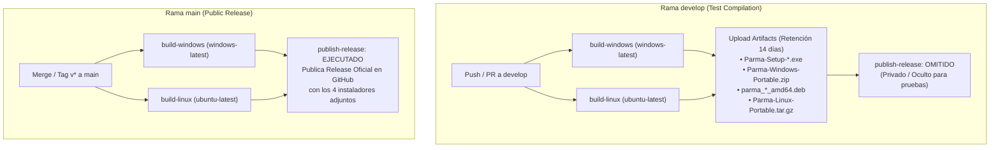

# 🚀 Parma — CI/CD, Empaquetado y Distribución Multiplataforma

Este documento formaliza la arquitectura completa de Integración y Entrega Continua (CI/CD) de **Parma (Character Hub & Grimoire)**, el ciclo de vida entre ramas, el empaquetado nativo para Windows y Linux y el catálogo completo de problemas resueltos.

---

## 1. Ciclo de Vida de Ramas: Estrategia Dual

El flujo de trabajo definido en [.github/workflows/build-and-release.yml](file:///home/nathanielwrk/Documentos/Proyects/Dnd_Player_Dashboard/.github/workflows/build-and-release.yml) implementa una estricta separación de ambientes:

### Comportamiento por Rama:
1. **En `develop` (Test Compilation / Oculto):**
   * Se compila el instalador `.exe`, el portable `.zip`, el paquete `.deb` y el tarball `.tar.gz`.
   * Los descargables quedan resguardados internamente en la sección **Artifacts** de la ejecución en GitHub Actions.
   * **No se publica ninguna Release en el perfil público**, permitiendo probar y validar sin ensuciar la portada del repositorio.
2. **En `main` (Public Release Oficial):**
   * Al realizar el merge final o subir un tag `v*`, se ejecutan las mismas compilaciones probadas.
   * El paso final `publish-release` descarga los binarios de ambos runners y genera automáticamente la **Release pública** con changelog de versión, visible para todos los usuarios.

---

## 2. Detalle de los Jobs de Compilación

### A. Windows (`build-windows` en `windows-latest`)
* **Entorno:** Windows Server 2022 / Windows 11 runner.
* **Variables de entorno:** `PYTHONUTF8: '1'` y `PYTHONIOENCODING: 'utf-8'` para evitar errores de decodificación en consolas de PowerShell.
* **Pasos:**
  1. Configuración de **Node.js 22** y **Python 3.11**.
  2. Detección inteligente de **Inno Setup Compiler (`ISCC.exe`)**; si no está preinstalado, lo instala automáticamente vía Chocolatey (`choco install innosetup`).
  3. `npm install --include=optional --no-audit` (descarga binarios nativos cruzados para Windows).
  4. `npx tsc -b` (paso de verificación estricta de tipos aislado).
  5. `npm run build` (compilación de producción con Vite 8).
  6. Instalación de dependencias Python de `requirements.txt` (incluyendo FastAPI, Uvicorn, WebSockets y QRCode).
  7. Generación de iconos multi-resolución adaptativos (`scripts/generate_taskbar_icons.py`).
  8. Empaquetado PyInstaller en carpeta portable (`python build_desktop.py`).
  9. Compilación del instalador guiado con Inno Setup:
     `& $iscc "ejecutables\windows\installer\parma_setup.iss"`.
  10. Carga de artefactos `Parma-Setup-*.exe` y `Parma-Windows-Portable.zip`.

### B. Linux (`build-linux` en `ubuntu-latest` / Ubuntu 24.04)
* **Entorno:** Ubuntu 24.04 LTS (Noble Numbat).
* **Pasos:**
  1. Configuración de **Node.js 22** y **Python 3.12**.
  2. Instalación de cabeceras de sistema nativas C (`build-essential`, `pkg-config`, `meson`, `ninja-build`, `libcairo2-dev`, `gir1.2-webkit2-4.1`, `python3-gi`, `dpkg`).
  3. Soporte para el nuevo GLib 2.80: instalación de `libgirepository-2.0-dev` con fallback resiliente a `libgirepository1.0-dev`.
  4. `npx tsc -b` y `npm run build` en el frontend.
  5. Compilación nativa de `PyGObject` y `pycairo` contra las cabeceras de Python 3.12 del sistema.
  6. Compilación de la carpeta portable `Parma/` con PyInstaller.
  7. Inclusión del script lanzador [parma.sh](file:///home/nathanielwrk/Documentos/Proyects/Dnd_Player_Dashboard/ejecutables/linux/parma.sh) con permisos de ejecución `755` y empaquetado del tarball portable `Parma-Linux-Portable.tar.gz`.
  8. Generación del paquete Debian oficial mediante [build_deb.py](file:///home/nathanielwrk/Documentos/Proyects/Dnd_Player_Dashboard/ejecutables/linux/deb/build_deb.py) con permisos estrictos de directorios (`0o755`) y control sin saltos de línea sobrantes.
  9. Carga de artefactos `parma_*_amd64.deb` y `Parma-Linux-Portable.tar.gz`.

---

## 3. Catálogo de Problemas Resueltos y Soluciones

| # | Problema Detectado | Causa Raíz Técnica | Solución Implementada |
| :--- | :--- | :--- | :--- |
| **1** | Incompatibilidad de Node.js con Vite 8 | `node-version: 20` incompatible con Vite 8 (`engines >=22.12.0`). | Actualización universal a **Node.js 22** en ambos runners. |
| **2** | Paquetes nativos de Tailwind faltantes en Windows | `npm ci` respetaba el `package-lock.json` de Linux y omitía `@tailwindcss/oxide-win32-x64-msvc`. | Sustitución por `npm install --include=optional --no-audit`. |
| **3** | Módulos backend faltantes en PyInstaller | `fastapi`, `uvicorn`, `websockets`, `qrcode` ausentes en `requirements.txt`. | Dependencias agregadas y registradas como `--hidden-import` en `build_desktop.py`. |
| **4** | Error de directiva en Inno Setup | `ArchitecturesAllowed=x64compatible` rechazado por versiones estándar de Inno Setup 6. | Reemplazado por la directiva estándar `x64` en `parma_setup.iss`. |
| **5** | Enlace C roto de PyGObject en Ubuntu 24.04 | Ubuntu 24.04 migró `gobject-introspection` a `libgirepository-2.0-dev`. | Instalación explícita de `libgirepository-2.0-dev` y compilación bajo Python 3.12. |
| **6** | Rechazo de `dpkg-deb` por permisos y sintaxis | `DEBIAN/control` sin salto final `\n` y directorios con permisos `775` (rechazados por Debian Policy). | Forzado recursivo de permisos `0o755` y normalización de `\n` en `build_deb.py`. |
| **7** | Error TS5110 en `tsconfig.node.json` | Configuración `"module": "nodenext"` sin resolución emparejada para el bundler. | Estandarizado a `"module": "ESNext"` y `"moduleResolution": "Bundler"`. |
| **8** | Rechazo de tipos estrictos en TypeScript (`SpellStatsData`) | Propiedades obligatorias de Python marcadas como opcionales (`?`), causando errores `TS2345` y `TS18048`. | `ability: string`, `dc: number`, `attack_bonus: number` definidos como obligatorios en `types.ts`. |
| **9** | Diagnóstico lento de fallos de frontend | `tsc -b` fallaba dentro de `python build_desktop.py`, ocultando los logs directos de TypeScript. | Creación del paso explícito y aislado `Verificar Tipos del Frontend (tsc)` previo al build. |
| **10** | Error `FileNotFoundError` de PyMuPDF en Windows | PyMuPDF 1.24+ intenta cargar archivos de layout ONNX no empaquetados por `--hidden-import`. | Sustitución por `--collect-all=pymupdf` e importación directa `import fitz as pymupdf`. |
| **11** | Icono de escritorio en blanco (hoja blanca) | El acceso directo apuntaba a `{app}\parma.ico` ausente en la raíz de instalación. | Apuntado directo al icono embebido en `{app}\Parma.exe` y copia explícita de `parma.ico` en Inno Setup. |
| **12** | Desinstalador no accesible tras instalar | Inno Setup no creaba acceso directo al desinstalador en el grupo de programas. | Creación de acceso directo `{group}\Desinstalar Parma` (`{uninstallexe}`) y registro en Configuración de Windows. |
