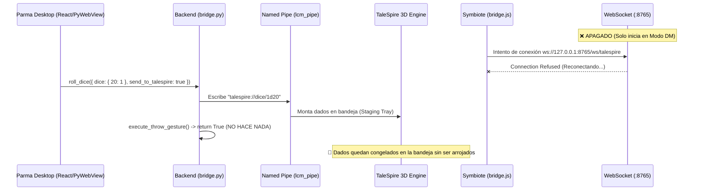
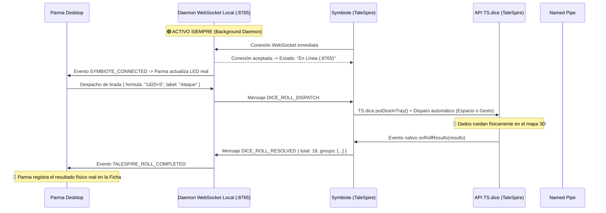

# 🎲 Diagnóstico Técnico y Hoja de Ruta de Reparación: TaleSpire Symbiote & Parma Dice Bridge

**Documento:** `docs/DIAGNOSTICO_TALESPIRE_SYMBIOTE.md`  
**Rama:** `develop`  
**Fecha:** 2026-11-02  
**Estado:** `Análisis Consolidado & Plan de Acción para Entorno de Desarrollo (Desktop)`

---

## 1. Resumen del Problema Reportado

Al ejecutar **Parma Desktop** junto a **TaleSpire** con el plugin **Parma Dice Bridge (Symbiote)**:
1. **Dentro de TaleSpire**: El panel web del Symbiote aparece correctamente (muestra *Tirada Recibida*, *Último Resultado*, *Puente en Segundo Plano* y *Pruebas de Bandeja 3D*), pero la insignia de estado permanece permanentemente en **`Reconectando...`** (en rojo) y nunca pasa a estado conectado.
2. **En la interfaz de Parma**: El indicador de TaleSpire en cabecera y ajustes figura como **`Conectado exitosamente`**.
3. **Al lanzar dados desde Parma**: Los dados aparecen colocados en la bandeja inferior de TaleSpire (staging en tray), pero **no ruedan ni se lanzan físicamente a la mesa 3D**, quedándose retenidos en la bandeja como sucedía en las fases iniciales antes del script de automatización.

---

## 2. Diagnóstico de Causa Raíz (RCA)

Tras inspeccionar minuciosamente el código del backend Python (`core/talespire_bridge.py`, `desktop_api/bridge.py`, `desktop_api/session_server.py`) y del Symbiote JavaScript (`talespire_symbiote/bridge.js`, `manifest.json`), se identifican **tres discrepancias arquitectónicas fundamentales**:

### Causa Raíz 1: El servidor WebSocket no está levantado (Puerto 8765 cerrado)
* **En el Symbiote (`talespire_symbiote/bridge.js` líneas 6-87)**:
  El script cliente intenta conectarse a `ws://127.0.0.1:8765/ws/talespire` (y rota a 8766-8768 si falla).
* **En el Backend Python (`desktop_api/session_server.py` y `desktop_api/bridge.py`)**:
  El endpoint WebSocket `/ws/talespire` está declarado dentro de `DmSessionServer`. Sin embargo, `DmSessionServer` **únicamente se inicia cuando el usuario hace clic explícito en "Iniciar Sesión Online DM"** (`start_dm_session`).
* **Consecuencia**:
  En partidas normales locales o de jugador, el servidor FastAPI/WebSocket **no se encuentra en ejecución en segundo plano**. Ningún proceso está escuchando en el puerto 8765. Por eso, el Symbiote dentro de TaleSpire sufre *Connection Refused*, rota de puerto en puerto y muestra indefinidamente `Reconectando...`.

---

### Causa Raíz 2: Falsa paridad de estado en Parma ("Conectado")
* **En el Backend Python (`core/talespire_bridge.py` líneas 227-265)**:
  El método `TaleSpireBridge.connect()` comprueba dos cosas:
  1. Que TaleSpire esté instalado en el disco (`is_installed == True`).
  2. Que el proceso `TaleSpire.exe` esté activo en la tabla de procesos del sistema operativo (`is_process_running() == True`).
* Si `TaleSpire.exe` está en memoria, marca `self.state = TaleSpireState.CONNECTED`.
* **Consecuencia**:
  Parma reporta `Conectado exitosamente` porque detectó la ventana/proceso de TaleSpire en ejecución, **pero jamás comprobó si el canal de comunicación WebSocket del Symbiote estaba realmente enganchado**. Son dos capas totalmente desconectadas:
  - *Capa A (Legacy OS)*: Proceso `TaleSpire.exe` detectado $\rightarrow$ Parma dice "Conectado".
  - *Capa B (Symbiote)*: WebSocket `ws://127.0.0.1:8765` caído $\rightarrow$ Symbiote dice "Reconectando".

---

### Causa Raíz 3: Por qué los dados quedan atrapados en la bandeja sin rodar
* **En `desktop_api/bridge.py` (líneas 792-801)**:
  Al pulsar *Lanzar Dados*, Parma ejecuta:
  ```python
  url = self._ts.build_pool_url(ts_pool, modifier=modifier, label=label)
  ts_sent = self._ts.send_roll(url)  # Escribe en \\.\pipe\com.bouncyrock.talespire.lcm_pipe
  if ts_sent:
      self._ts.execute_throw_gesture(ts_mode=ts_mode)
  ```
* **En `core/talespire_bridge.py` (líneas 354-377)**:
  1. `self._ts.send_roll(url)` escribe la URL `talespire://dice/...` al Named Pipe nativo de TaleSpire. Por diseño del motor de Unity de TaleSpire, **el Pipe únicamente monta los dados en la bandeja de preparación (`UIDiceTray.SetDiceUrl()`), NO los lanza a la mesa**.
  2. El método `execute_throw_gesture()` (que antes emulaba el arrastre del ratón para arrojar los dados) fue desactivado y sustituido por un dummy `return True` bajo la premisa de que el Symbiote oficial resolvería el lanzamiento.
  3. Pero como el Symbiote no está conectado por WebSocket (Causa 1), Parma nunca le envía la orden de tirada al Symbiote.
  4. Adicionalmente, en la API oficial de Symbiotes de TaleSpire (`TS.dice.putDiceInTray`), la función también **coloca los dados en la bandeja**, requiriendo que el jugador presione la barra espaciadora o haga clic para arrojarlos, a menos que se invoque un disparador de teclado o gesto físico coordinado.

---

## 3. Diagrama de la Arquitectura Actual vs Arquitectura Corregida

### Flujo Roto Actual


### Flujo Corregido Propuesto


---

## 4. Plan de Reparación Paso a Paso (Checklist para el Desktop)

### Paso 1: Servidor WebSocket Local Permanente (Zero-Config)
* **Archivo afectado**: `desktop_api/bridge.py` o `desktop_app.py`.
* **Solución**:
  Actualmente `DmSessionServer` solo arranca al pulsar "Iniciar Campaña Online". Se debe desacoplar el canal local de TaleSpire para que arranque un hilo ligero con un servidor WebSocket (o que `DmSessionServer` mantenga activa la ruta `/ws/talespire` localmente desde el inicio de Parma en `127.0.0.1:8765`).

### Paso 2: Sincronización Real del Indicador de Estado
* **Archivo afectado**: `core/talespire_bridge.py` y `frontend/src/components/Header.tsx`.
* **Solución**:
  - `state_label` o `symbiote_connected` debe reflejar verdaderamente si hay un socket activo en `ConnectionManager.symbiote_socket`.
  - Si el juego está abierto pero el Symbiote no ha conectado el socket, el indicador debe mostrar `TaleSpire Abierto (Esperando Symbiote)` en lugar de `Conectado`.

### Paso 3: Lanzamiento Físico de Dados (Resolver el "Solo Bandeja")
* **Opciones a probar en tu máquina con TaleSpire abierto**:
  - **Opción A (Nativa Symbiote API)**: Verificar en la consola de TaleSpire (`F12` / Chromium DevTools) si la versión actual de la API de Symbiote expone algún método directo para arrojar los dados tras montarlos con `TS.dice.putDiceInTray`.
  - **Opción B (Disparo por Tecla Espacio)**: Al enviar la tirada mediante el Pipe o Symbiote, emitir una pulsación simulada de la tecla `Space` hacia la ventana de TaleSpire usando la API de Windows (`SendMessage(hwnd, WM_KEYDOWN, VK_SPACE, ...)` o `pyautogui.press('space')`). Al presionar Espacio, TaleSpire arroja inmediatamente los dados de la bandeja al tablero 3D con impulso físico uniforme, sin necesidad de arrastrar el cursor del ratón.
  - **Opción C (Micro-Gesto Restaurado y Calibrado)**: Reactivar el micro-gesto en `execute_throw_gesture` calibrado con las coordenadas del centro de la bandeja si el usuario prefiere no enviar pulsaciones de teclado.

### Paso 4: Rediseño del Panel de Pruebas del Symbiote
* **Archivo afectado**: `talespire_symbiote/index.html`.
* **Solución**:
  Reemplazar los tres botones separados (`1d20+5`, `2d6+3`, `4d6`) por una barra con un selector o campo editable y un botón principal consolidado **`[ 🎲 Test ]`**, permitiendo probar cualquier fórmula con un solo clic.

---

## 5. Instrucciones para Pruebas en el Equipo de Escritorio (Desktop)

Cuando hagas `git pull` en la rama `develop` en tu PC de escritorio:

1. **Comprobar si el puerto 8765 está escuchando**:
   En PowerShell o CMD de Windows:
   ```cmd
   netstat -ano | findstr 8765
   ```
   Si no devuelve nada, confirma que el servidor WebSocket no estaba levantado.
2. **Abrir la consola de depuración del Symbiote en TaleSpire**:
   - Inicia TaleSpire con el parámetro de lanzamiento `--enable-symbiote-dev` o abre el Symbiote y presiona `Ctrl + Shift + I` / `F12` para ver la consola de Chromium embebida en TaleSpire.
   - Observa si imprime los errores de `WebSocket connection to 'ws://127.0.0.1:8765/ws/talespire' failed`.
3. **Probar la tecla Espacio sobre la bandeja**:
   - Cuando Parma ponga los dados en la bandeja de TaleSpire, presiona la tecla `Espacio` en el teclado con la ventana de TaleSpire activa. Verás que los dados salen disparados a rodar físicamente en la mesa. Esa es la confirmación de que la automatización de la tecla `Espacio` es la vía más limpia y no invasiva para completar la tirada.
