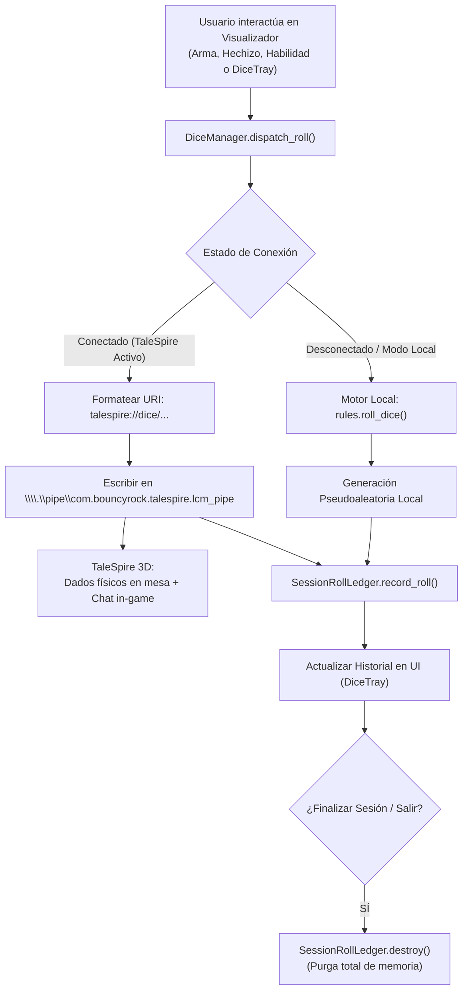
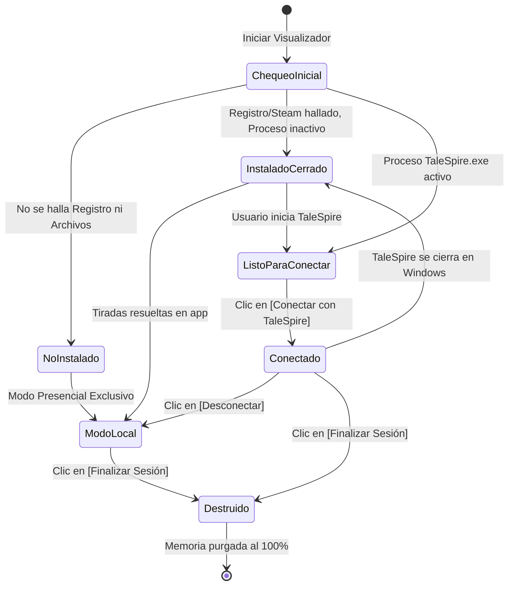

# Especificación de Arquitectura e Integración: TaleSpire Dice Bridge & Session Ledger

**Documento:** `docs/INTEGRACION_TALESPIRE_DICE_BRIDGE.md`  
**Estado:** `Especificación Técnica & Guía de Implementación (Revisión Final)`  
**Plataformas:** Windows x86_64 (Nativo) / Linux (Modo Local & Soporte Proton/Wine)  
**Módulos Afectados:** `flet_app/core/talespire_bridge.py`, `flet_app/core/session_ledger.py`, `flet_app/ui/components/dice_tray.py`, `flet_app/main.py`

---

## 1. Resumen Ejecutivo y Objetivos

El objetivo de esta integración es conectar el **Visualizador & Editor D&D 5e** con una sesión activa de **TaleSpire** de forma completamente transparente, garantizando estabilidad en partidas de larga duración (3 a 5 horas), control total del usuario sobre la conexión, combinación flexible de dados y fallback local:

1. **Persistencia en Partidas Largas (Sin Desconexiones Falsas)**:
   * La sesión permanece en estado **Conectado** de forma persistente hasta que el usuario decida desconectarse explícitamente o finalice la sesión.
   * Se elimina cualquier sondeo periódico agresivo que desconecte el puente a mitad de una partida.
2. **Ciclo de Conexión Manual y Control del Usuario**:
   * Botón explícito **`[Conectar con TaleSpire]`** para enganchar la sesión.
   * Botón explícito **`[Desconectar]`** para volver al modo mesa local en cualquier momento sin cerrar TaleSpire.
3. **Detección Tripartita del Estado de TaleSpire**:
   * **Conectado (Sesión Activa):** TaleSpire abierto y sincronizado. Las tiradas se lanzan en la mesa 3D y se registran en el visualizador.
   * **Instalado pero Cerrado:** Presente en el sistema (registro de Windows o Steam), pero `TaleSpire.exe` inactivo. Avisa: *"TaleSpire no está abierto. Inicia el juego antes de conectar."* El modo local opera normalmente sin enviar nada al pipe.
   * **No Instalado / No Detectado:** El sistema no localiza el juego y opera en modo presencial permanente.
4. **Constructor de Pool de Dados Combinados (Multi-Dice Pool Builder)**:
   * Resuelve el problema de reemplazo de dados: permite acumular distintos dados simultáneamente (ej. $1d20 + 2d6 + 1d8 + 3$) y lanzarlos juntos con un único botón de lanzamiento.
5. **Automatización del Gesto "Draw" (Lanzamiento Físico 3D)**:
   * Análisis de la física interna de TaleSpire (`LinearVelocity`, `AngularVelocity`, `RollDriver`) y opciones para automatizar el lanzamiento con movimiento elíptico o mods sin requerir arrastre manual del ratón.
6. **Registro de Sesión Efímero (Volatile Session Ledger)**:
   * Historial de tiradas conservado durante la partida que se **destruye y purga al 100%** al finalizar la sesión o cerrar la app.

---

## 2. Arquitectura del Sistema y Flujo de Datos



---

## 3. Máquina de Estados del Puente (State Machine)



---

## 4. Protocolo de Comunicación con TaleSpire

### 4.1 Canal IPC (Named Pipe)
* **Nombre del Pipe en Windows:** `\\.\pipe\com.bouncyrock.talespire.lcm_pipe`
* **Dirección:** Salida unidireccional (Cliente ➔ TaleSpire).
* **Modo de Transmisión:** Mensaje de texto UTF-8 terminado en salto de línea (`\n`).

### 4.2 Gramática de Fórmulas (`talespire://dice/`)
* **Estructura base:** `talespire://dice/[Etiqueta:]<Cantidad>d<Caras>[+Mod|-Mod]`
* **Caras permitidas:** `4`, `6`, `8`, `10`, `12`, `20`, `100`.
* **Límite de dados:** Máximo 40 dados físicos totales por tirada.
* **Separador de grupos múltiples:** Carácter `/`. Cada grupo se resuelve de forma independiente en su propia bandeja.
* **Ejemplo combinado:** `talespire://dice/Ataque:1d20+7/Dano:2d6+1d8+4`

---

## 5. Módulos de Código

### 5.1 Módulo del Puente: `flet_app/core/talespire_bridge.py`

```python
"""
Módulo de Integración y Puente con TaleSpire.
Soporta detección de instalación, control de proceso y sesión persistente.
"""
import sys
import os
import subprocess
from enum import Enum
from typing import Optional, Dict, Any, List

PIPE_NAME = r'\\.\pipe\com.bouncyrock.talespire.lcm_pipe'
URI_SCHEME = "talespire://dice/"


class TaleSpireState(Enum):
    NOT_INSTALLED = "not_installed"        # No hay rastro de TaleSpire en el equipo
    INSTALLED_CLOSED = "installed_closed"  # Instalado pero el juego no está abierto
    RUNNING_IDLE = "running_idle"          # Abierto pero no conectado por el usuario
    CONNECTED = "connected"                # Sesión activa: tiradas enviadas al 3D


class TaleSpireBridge:
    def __init__(self):
        self.state: TaleSpireState = TaleSpireState.NOT_INSTALLED
        self.is_installed: bool = False
        self._check_installation()

    def _check_installation(self) -> bool:
        """Verifica si TaleSpire está instalado mediante el registro de Windows o Steam."""
        if sys.platform != "win32":
            self.is_installed = False
            self.state = TaleSpireState.NOT_INSTALLED
            return False

        try:
            import winreg
            with winreg.OpenKey(winreg.HKEY_CLASSES_ROOT, r"talespire\shell\open\command") as key:
                val, _ = winreg.QueryValueEx(key, "")
                if val and "TaleSpire" in val:
                    self.is_installed = True
                    self.state = TaleSpireState.INSTALLED_CLOSED
                    return True
        except (OSError, ImportError):
            pass

        steam_paths = [
            r"C:\Program Files (x86)\Steam\steamapps\common\TaleSpire\TaleSpire.exe",
            r"C:\Program Files\Steam\steamapps\common\TaleSpire\TaleSpire.exe"
        ]
        for p in steam_paths:
            if os.path.exists(p):
                self.is_installed = True
                self.state = TaleSpireState.INSTALLED_CLOSED
                return True

        self.is_installed = False
        self.state = TaleSpireState.NOT_INSTALLED
        return False

    def is_process_running(self) -> bool:
        """Comprueba si el proceso TaleSpire.exe está actualmente en memoria."""
        if sys.platform != "win32":
            return False

        try:
            output = subprocess.check_output(
                'tasklist /FI "IMAGENAME eq TaleSpire.exe" /NH',
                shell=True,
                text=True,
                creationflags=subprocess.CREATE_NO_WINDOW if hasattr(subprocess, "CREATE_NO_WINDOW") else 0
            )
            return "TaleSpire.exe" in output
        except Exception:
            return False

    def connect(self) -> tuple[bool, str]:
        """Engancha la sesión activa con TaleSpire."""
        if not self.is_installed:
            self.state = TaleSpireState.NOT_INSTALLED
            return False, "TaleSpire no está instalado en este sistema."

        if not self.is_process_running():
            self.state = TaleSpireState.INSTALLED_CLOSED
            return False, "TaleSpire no está abierto. Inicia el juego antes de conectar."

        self.state = TaleSpireState.CONNECTED
        return True, "Conectado exitosamente con TaleSpire."

    def disconnect(self) -> None:
        """Desconecta la sesión manual y vuelve a modo local."""
        if self.is_installed:
            self.state = TaleSpireState.INSTALLED_CLOSED if not self.is_process_running() else TaleSpireState.RUNNING_IDLE
        else:
            self.state = TaleSpireState.NOT_INSTALLED

    def is_session_connected(self) -> bool:
        """Verifica si la sesión debe despachar al juego."""
        if self.state != TaleSpireState.CONNECTED:
            return False
        if not self.is_process_running():
            self.state = TaleSpireState.INSTALLED_CLOSED
            return False
        return True

    def build_roll_url(self, groups: List[Dict[str, Any]]) -> str:
        """Genera el URI talespire://dice/... validando el límite de 40 dados."""
        parts = []
        total_dice = 0
        for g in groups:
            count = max(1, g.get("count", 1))
            total_dice += count
            sides = g.get("sides", 20)
            mod = g.get("mod", 0)
            label = g.get("label", "").strip()

            mod_str = f"+{mod}" if mod > 0 else (f"{mod}" if mod < 0 else "")
            core_roll = f"{count}d{sides}{mod_str}"
            if label:
                clean_label = label.replace(":", "").replace("/", "")
                parts.append(f"{clean_label}:{core_roll}")
            else:
                parts.append(core_roll)

        if total_dice > 40:
            raise ValueError(f"TaleSpire no admite más de 40 dados simultáneos ({total_dice} solicitados).")

        return URI_SCHEME + "/".join(parts)

    def send_roll(self, roll_url: str) -> bool:
        """Escribe la tirada directamente al Pipe IPC de TaleSpire."""
        if not self.is_session_connected():
            return False

        try:
            with open(PIPE_NAME, 'w', encoding='utf-8', buffering=1) as pipe:
                pipe.write(f"{roll_url}\n")
                pipe.flush()
            return True
        except Exception:
            if not self.is_process_running():
                self.state = TaleSpireState.INSTALLED_CLOSED
            return False
```

---

### 5.2 Módulo del Registro Efímero: `flet_app/core/session_ledger.py`

```python
"""
Registro Volátil de Sesión (Session Roll Ledger).
Garantiza que el historial exista solo durante la partida activa.
"""
import time
from typing import List, Optional
from dataclasses import dataclass


@dataclass
class RollEntry:
    id: int
    timestamp: float
    time_str: str
    character_name: str
    reason: str
    formula: str
    detail: str
    total: int
    is_crit: bool
    is_fumble: bool
    channel: str  # 'TaleSpire 3D' o 'Motor Local'


class SessionRollLedger:
    _instance: Optional['SessionRollLedger'] = None

    def __init__(self):
        self.session_active: bool = True
        self.entries: List[RollEntry] = []
        self._next_id: int = 1

    @classmethod
    def get_current(cls) -> 'SessionRollLedger':
        if cls._instance is None:
            cls._instance = cls()
        return cls._instance

    def record_roll(self, character_name: str, reason: str, formula: str, detail: str, total: int, is_crit: bool = False, is_fumble: bool = False, channel: str = "Motor Local") -> RollEntry:
        now = time.time()
        entry = RollEntry(
            id=self._next_id,
            timestamp=now,
            time_str=time.strftime("%H:%M:%S", time.localtime(now)),
            character_name=character_name or "Héroe",
            reason=reason or "Tirada Libre",
            formula=formula,
            detail=detail,
            total=total,
            is_crit=is_crit,
            is_fumble=is_fumble,
            channel=channel
        )
        self._next_id += 1
        self.entries.insert(0, entry)
        return entry

    def destroy_session(self) -> None:
        """Purga el 100% de los datos en memoria al terminar la sesión."""
        self.entries.clear()
        self._next_id = 1
        self.session_active = False
        SessionRollLedger._instance = None
```

---

## 6. Física de Lanzamiento ("Draw") en TaleSpire

### 6.1 Anatomía del Gesto "Draw" (Ingeniería Inversa con REA)
Al examinar las clases internas `Dice.RollDriver`, `Dice.Die` y `Dice.LinearVelocity`:
1. **Estado Staged en Bandeja:** Al recibir una URL, TaleSpire genera los modelos 3D y los mantiene retenidos en la bandeja inferior (`UIDiceTray`) a la espera del gesto del ratón.
2. **Cálculo de Fuerzas Físicas:** El arrastre del ratón ("Draw") calcula:
   * $\vec{v}_{\text{linear}}$: Dirección del arrastre $\times$ fuerza de aceleración.
   * $\vec{\omega}_{\text{angular}}$: Torsión angular inducida por la curvatura del gesto.

### 6.2 Automatización del Lanzamiento sin Ratón Manual

#### Opción A: Script de Movimiento Elíptico ("Circle Flick & Throw")
Simula el gesto de arrastre circular mediante la API de Windows con Python:
```python
import math
import pyautogui

def simular_gesto_draw(radio: int = 50, pasos: int = 10):
    """Realiza un giro circular y un impulso frontal para soltar los dados en TaleSpire."""
    cx, cy = pyautogui.position()
    pyautogui.mouseDown(button='left')
    
    # Vuelta circular de aceleración (rotación de dados)
    for i in range(pasos):
        angulo = (2 * math.pi / pasos) * i
        x = cx + int(radio * math.cos(angulo))
        y = cy + int(radio * math.sin(angulo))
        pyautogui.moveTo(x, y, duration=0.01)
        
    # Impulso frontal hacia el centro de la mesa
    pyautogui.moveTo(cx, cy - 140, duration=0.07)
    pyautogui.mouseUp(button='left')
```

#### Opción B: Hook de Modding en C# (BepInEx)
```csharp
[HarmonyPatch(typeof(DiceRollManager), "AddDiceToTray")]
public static class AutoThrowPatch {
    public static void Postfix() {
        RollDriver.Instance.ExecuteAutoThrow(forwardForce: 14f, torqueStrength: 22f);
    }
}
```

---

## 7. Constructor de Pool de Dados Combinados (Multi-Dice Pool Builder)

La interfaz de `DiceTray` implementa un **Selector Ergonómico con Stepper y Calibración de Modo**:

```text
┌────────────────────────────────────────────────────────┐
│ 🎲 Tirador & Pool de Dados         [TaleSpire Conectado]│
│ Modo TaleSpire: [👤 Jugador]  [👑 DM / Host]           │
├────────────────────────────────────────────────────────┤
│ Dados:    [ d20 ] [ d12 ] [ d10 ] [ d8 ] [ d6 ] [ d4 ] │
│ Stepper:  d20:  [ ◄ ] [ 1 ] [ ► ]           [ + Añadir ]│
│                                                        │
│ Pool:     [ 2d20 ✕ ]  [ 3d8 ✕ ]                        │
│                                                        │
│ Modo: (•) Normal ( ) Ventaja ( ) Desv      Mod: [ +3 ] │
├────────────────────────────────────────────────────────┤
│ [ 🎲 LANZAR DADOS ]                          [ Limpiar ]│
├────────────────────────────────────────────────────────┤
│ 15:12:15 • Pool de Dados                     Total: 39 │
│ 2d20(11, 19) + 3d8(1, 4, 4) + 3 = 39                   │
└────────────────────────────────────────────────────────┘
```

* **Calibración de Modo TaleSpire:** Selector en la cabecera entre `👤 Jugador` (altura ~16%) y `👑 DM / Host` (altura ~24% para compensar la barra inferior de construcción y turnos).
* **Botonera de Dados Organizada:** Caras ordenadas de forma decreciente (`d20`, `d12`, `d10`, `d8`, `d6`, `d4`, `d100`) con resaltado dorado sutil en el dado seleccionado.
* **Stepper Ergonómico:** Flechas laterales `[ ◄ ]` y `[ ► ]` para ajustar la cantidad deseada (`tic, tic, tic`) y botón explícito **`[ + Añadir ]`** para incorporar los dados al pool activo.
* **Sincronización en Vivo:** Al pulsar `+ Añadir`, los dados se envían de inmediato al tray 3D de TaleSpire (`_sync_staging_to_talespire`).
* **Limpieza Reactiva:** El botón `[Limpiar]` vacía el pool y refresca inmediatamente los contenedores visuales de Flet.

---

## 8. Ciclo de Vida de la Sesión y Destrucción de Datos

1. **Botón "Finalizar Sesión & Purgar":**
   * Diálogo de confirmación: *"¿Finalizar sesión de juego? El registro de tiradas de esta sesión será eliminado permanentemente."*
   * Ejecuta `ledger.destroy_session()`, vacía los controles visuales y libera la memoria RAM.
2. **Gancho `page.on_close`:**
   * Al cerrar la ventana del visualizador, purga inmediatamente el historial en memoria para no dejar rastro en disco.

---

## 9. Simulación de Lanzamiento Físico y Registro de Sumatoria

1. **Arrastre Multi-Cuadro Interpolado (~100ms):**
   * Al pulsar `"🎲 Lanzar Dados"`, `execute_throw_gesture(ts_mode)` ubica el ratón sobre la caja de dados preparados (`30%` en GM, `24%` en Jugador), sostiene `LEFTDOWN` durante 20ms, interpola un arrastre vertical ascendente en 5 pasos de 16ms cada uno (coincidiendo con los 60 FPS de Unity) y suelta en vuelo. Esto permite que `DiceBoardTool` acumule aceleración positiva y despache físicamente `ThrowDice` antes de restaurar el cursor a la mano del usuario.
2. **Consistencia Total del Registro de Sesión (Sin Invención de Números):**
   * Cuando TaleSpire está conectado, el Visualizador **no inventa números aleatorios locales**. Registra claramente `"🎲 En mesa 3D"` delegando el veredicto final al resultado físico de los dados en TaleSpire.
   * El pool de dados en el constructor permanece activo y no se vacía automáticamente tras lanzar, permitiendo re-lanzar los mismos dados (por ejemplo 4d20) tantas veces como se desee sin que regrese repentinamente a 1d20. El vaciado se realiza exclusivamente con el botón `[Limpiar]`.
3. **Alternativa Nativa por Mod (Sin Ratón):**
   * Se incluye el plugin BepInEx `data/talespire_mods/AutoThrowPatch.cs` que permite expulsar los dados automáticamente en 3D al recibirlos por el Pipe sin mover el cursor físico en lo absoluto.

---

## 10. Reporte Técnico de Ingeniería Inversa (REA & CIL Decompilation)

A partir del análisis en profundidad del binario `TaleSpire_Data\Managed\Bouncyrock.TaleSpire.Runtime.dll`:

### 10.1 Estructura del Tray (`UIDiceTray`)
* **Jerarquía UI:** Contiene `_diceTrayTransform` y `_diceUrlTrayTransform` como `RectTransform` anclados horizontalmente al centro (`anchorMin.x = 0.5, anchorMax.x = 0.5, pivot.x = 0.5`).
* **Animación Tween:** Gestionado por `RectTransformTweener _tweener`. Al recibir datos vía `SetDiceUrl`, `CheckVisibility` evalúa `HasActiveChildren()` y ejecuta `_tweener.TweenForward()`, deslizando la bandeja hacia arriba.
* **Coordenadas Dinámicas por Resolución (Calibración Píxel a Píxel sobre Caja de Dados Preparados `[1 D20]`):**
  * **Eje Horizontal (X):** `X = window_left + (window_width / 2)` (estrictamente centrado para cualquier resolución o relación de aspecto; en 1080p, `X = 960px`).
  * **Eje Vertical (Y) - Modo DM / Host (Activo por defecto):** `Y = window_bottom - (window_height * 0.300)` (~324px del fondo en 1080p, `Y = 756px`). Posiciona el agarre directamente sobre la caja oscura de dados preparados (`[1 D20]`), que flota por encima de la barra de botones `d4..d20`.
  * **Eje Vertical (Y) - Modo Jugador:** `Y = window_bottom - (window_height * 0.240)` (~259px del fondo en 1080p, `Y = 821px`), restando proporcionalmente los ~64px de la barra `'Open Library'` ausente en la interfaz limpia de jugador.
  * **Sincronización a 60 Hz:** Se configuran micro-tiempos de 20ms (Down) + 5 pasos de 16ms (Drag progresivo) + 25ms (Release) para garantizar que el motor de Unity capture el arrastre y calcule la aceleración de lanzamiento antes de soltar el botón.

### 10.2 Pipeline de Lanzamiento Físico
1. Al recibir la URL (`talespire://dice/...`), `UIDiceTray.SetDiceUrl()` monta los dados en la bandeja.
2. La interacción de arrastre o clic llama a `UIDiceTray.Spawn(bool isGmRoll)`:
   * Instancia física mediante `Dice.DiceRollManager.Instance.SpawnNewRoll(...)`.
   * Traspasa el control a `DiceBoardTool.SwitchToTool(rollId)`.
3. Al soltarse el ratón, `DiceBoardTool.End()` calcula la velocidad vectorial (`CalcThrowVelocity()`) y ejecuta `DiceRollManager.Instance.ThrowDice(rollId, velocity)`, expulsando los dados en la mesa 3D.
4. `BoardToolManager.Instance.SwitchToTool(null)` devuelve el control a la herramienta de tablero por defecto.

