# Parma D&D — Documentación de Arquitectura de Sesiones y Plan de Trabajo Detallado

**Fecha:** 23 de Octubre de 2026  
**Estado:** Fase de Iteración y Consolidación de Experiencia DM ↔ Jugadores  
**Autor:** Antigravity (Pair Programming con el Desarrollador)  

---

## 1. Historial de Problemas Previos y Resolución Técnica

Durante las pruebas iniciales entre dos dispositivos (DM en aplicación de escritorio y Jugador en navegador remoto / dispositivo móvil), se identificaron varias fallas arquitectónicas que impedían una experiencia fluida. A continuación se resume qué fallaba, por qué ocurría y cómo fue resuelto:

| Problema Observado | Causa Raíz Técnica | Solución Implementada |
| :--- | :--- | :--- |
| **"Mesa de Jugadores: 0" (El DM no ve a los jugadores)** | En `Header.tsx`, al unirse a una sesión solo se guardaba el ID en memoria local (`activeSessionId`). Nunca se ejecutaba una llamada HTTP al endpoint de registro `POST /api/player/join`. Por tanto, la tabla SQLite `dm_session_players` quedaba con 0 registros. | Se implementó el handshake formal en `api.joinPlayerSession`, que envía `token`, datos del personaje y el JSON estructurado al servidor, registrándolo de inmediato en la base de datos del DM. |
| **La ficha no se transmitía por WebSocket** | Al abrir el WebSocket (`ws.onopen`), se evaluaba `if (activeCharacter)`. Al cargar la página en web, `activeCharacter` arrancaba inicialmente en `null`, por lo que `SHEET_SYNC` nunca se despachaba. | Se añadió un efecto reactivo que sincroniza la ficha en cuanto se carga o actualiza en memoria, junto con el handshake HTTP inicial. |
| **Jugador "fantasma" que seguía "En Sesión" al cerrar el DM** | Al detener la sesión en el DM, el backend solo apagaba Uvicorn sin avisar a los sockets. En el cliente, no existía un manejador `onclose` o de evento `SESSION_CLOSED`, reteniendo el estado verde en el Header indefinidamente. | Se agregó `ConnectionManager.close_all()` que difunde `SESSION_CLOSED` a todos los clientes antes de desconectar, y el frontend limpia automáticamente `activeSessionId` y muestra un aviso amigable. |
| **Tiradas de dados no compartidas** | En modo navegador web, `rollDice` calculaba la tirada puramente en local sin emitir mensajes de red. En el DM, las tiradas registraban en el ledger local pero no se retransmitían por WebSocket. | Se integró un bus de eventos bidireccional (`DICE_ROLL` y `DICE_ROLL_SHARED`) tanto en el backend FastAPI como en el puente de escritorio (`bridge.py`) y `CharacterContext`. |
| **Dados que desaparecían demasiado rápido (2.4s)** | La animación de dados en pantalla (`DiceRollAnimation`) se cerraba automáticamente a los 2.4 segundos y tenía `pointer-events-none`, impidiendo leer o anotar los números con calma. | Se extendió el tiempo de visualización a **5 segundos**, se añadió el botón explícito de salida **"Anotar / Cerrar (Esc)"**, soporte para la tecla Escape y clic en el fondo para cerrar cuando el usuario lo desee (Ley de Hick). |

---

## 2. Plan de Trabajo: Nuevas Mejoras y Fases de Desarrollo

Este plan aborda las nuevas solicitudes para perfeccionar la ergonomía visual, organizar la bitácora del DM, permitir una auditoría exhaustiva de la ficha del jugador, añadir pergaminos narrativos a la forja y ajustar el icono de la aplicación.

```mermaid
flowchart TD
    subgraph "Fase 1: Bitácora Inteligente DM"
        A1[Eventos crudos en dm_session_logs] --> A2[Filtros por categoría: Tiradas / Combate y Daño / Sesión]
        A2 --> A3[Tarjetas de Daño destacadas con autor, fórmula y total]
    end

    subgraph "Fase 2: Ficha Completa del Jugador"
        B1[Mesa de Jugadores: Tarjetas compactas horizontales] --> B2[Botón 'Ver Ficha']
        B2 --> B3[Modal Hoja Completa: Stats, Salvaciones, Combate, Hechizos, Rasgos, Inventario]
    end

    subgraph "Fase 3: Forja Homebrew & Pergaminos"
        C1[Nueva Categoría: Pergamino / Documento] --> C2[Campo de texto enriquecido para redactar manuscritos]
        C2 --> C3[Selector de entrega directo en tarjeta a jugador conectado]
    end

    subgraph "Fase 4: Viñetas Visuales Cinemáticas"
        D1[Halo Rojo de Daño / Verde de Curación] --> D2[Bordes sutiles sin invadir el centro de la pantalla]
        D2 --> D3[Permanencia extendida a 1.8s - 2.0s para impacto dramático]
    end

    subgraph "Fase 5: Iconografía Desktop"
        E1[Escudo de Parma] --> E2[Generación / Configuración de icono Negro Sólido]
    end
```

---

### Fase 1: Bitácora y Filtro Limpio de Eventos en Consola DM
- **Objetivo:** Evitar la saturación visual separando los eventos en categorías claras y legibles.
- **Cambios a realizar:**
  1. En `DMConsoleView.tsx` (Pestaña Bitácora / Ledger), incorporar una botonera de pestañas/filtros rápidos:
     - **Todas:** Flujo cronológico completo.
     - **Tiradas de Dados:** Muestra únicamente lanzamientos de d20, armas, habilidades y salvaciones con autor y resultado.
     - **Combate y Daño:** Muestra golpes recibidos, daño infligido por el DM o curaciones.
     - **Sesión:** Conexiones, desconexiones y objetos mágicos entregados.
  2. Formatear las tiradas de daño con colores distintivos (rojo carmesí para daño, verde para curaciones) y desglose de fórmula para auditoría rápida del DM.

### Fase 2: Mesa de Jugadores y Modal de Ficha Completa ("Ver Ficha")
- **Objetivo:** Hacer la mesa más compacta y proporcionar una auditoría íntegra de la hoja de personaje sin saturar la pantalla.
- **Cambios a realizar:**
  1. **Tarjetas Compactas:** Rediseñar las tarjetas de la mesa de jugadores con una disposición más angosta y horizontal:
     - Retrato circular del personaje (`portrait_base64` o avatar).
     - Nombre, clase, nivel, CA y punto verde/gris de estado en línea.
     - Barra de vida interactiva y botones de acción rápida (-5, -1, +1, +5).
     - Botón único y sobrio: **"Ver Ficha"**.
  2. **Modal de Ficha Completa (Hoja de Personaje Vertical Scrolleable):**
     - Al pulsar *"Ver Ficha"*, abrir un modal amplio y cómodo con scroll vertical estructurado en secciones canónicas de D&D 5e:
       - **Encabezado Heroico:** Retrato en alta resolución, nombre, especie, clase, subclase, trasfondo, alineamiento, inspiración y bonificador de competencia.
       - **Vitalidad & Táctica:** HP actual / máximo / temporal, CA, Iniciativa, Velocidad, Dados de Golpe y Estado de Combate.
       - **Puntuaciones de Característica y Salvaciones:** Fuerza, Destreza, Constitución, Inteligencia, Sabiduría y Carisma con sus modificadores y salvaciones marcadas.
       - **Habilidades (Skills):** Lista alfabética con bonificadores calculados y marcas de competencia/pericia.
       - **Ataques y Acciones en Combate:** Armas equipadas, bonificador de ataque, dado de daño, tipo y notas especiales.
       - **Grimorio & Magia:** Espacios de conjuro por nivel (usados y restantes) y lista completa de conjuros preparados con sus detalles.
       - **Rasgos, Dotes y Habilidades:** Habilidades activas y pasivas de clase y especie.
       - **Inventario y Equipo:** Lista completa de objetos y riquezas.
     - Botón de cierre visible (✕) y soporte para tecla `Escape` y clic fuera del modal.

### Fase 3: Forja Homebrew: Pergaminos Narrativos y Selector de Entrega Directo
- **Objetivo:** Permitir entregar cartas, pistas o pergaminos escritos y facilitar la entrega de objetos desde la misma tarjeta.
- **Cambios a realizar:**
  1. **Categoría "Pergamino / Documento":**
     - Añadir en la forja la categoría `scroll` / `document` con el selector correspondiente.
     - Desplegar un campo de texto multilínea: *"Contenido del Pergamino / Texto del Documento"*, permitiendo al DM redactar mensajes, acertijos, contratos o cartas secretas.
  2. **Selector de Entrega Directo en la Tarjeta:**
     - En cada tarjeta de la biblioteca Homebrew del DM, incluir un botón *"Entregar a Jugador"* que abra un modal o menú desplegable con la lista de jugadores conectados actualmente en la mesa para enviárselo de inmediato con un solo clic.
  3. **Recepción en el Jugador:**
     - Cuando el jugador recibe un objeto de tipo Pergamino/Documento, se guarda en su inventario o rasgos con su texto completo, permitiéndole abrirlo y leer el pergamino en cualquier momento.

### Fase 4: Ergonomía Visual de Viñetas Cinemáticas (`ScreenVignette`)
- **Objetivo:** Hacer los halos rojo y verde más sutiles en los bordes y prolongar su duración para mayor impacto dramático.
- **Cambios a realizar:**
  1. **Ajuste de Grosor:** Modificar el sombreado interior de `ScreenVignette.tsx` de `inset 0 0 80px` a `inset 0 0 32px` con borde fino (`border-[2px]`), manteniendo el centro de la pantalla 100% limpio y sin obstrucciones.
  2. **Extensión de Duración:** Incrementar el temporizador de permanencia de los actuales 850ms a **1800ms - 2000ms**, con una transición CSS suave de entrada y salida (`transition-opacity duration-500`).

### Fase 5: Iconografía Desktop (Escudo de Parma en Negro Sólido)
- **Objetivo:** Configurar el icono de la ventana y barra de tareas para que use el escudo oficial de Parma en **color negro sólido**.
- **Cambios a realizar:**
  1. Utilizar el vector oficial `brand/es/icon-mono-black.svg` para generar las variantes `.ico` y `.png` en negro sólido de alta fidelidad.
  2. Actualizar `desktop_app.py` para cargar el icono negro sólido como la identidad visual predeterminada de la aplicación de escritorio.

---

## 3. Estado de Verificación y Criterios de Aceptación

- [ ] **Bitácora DM:** Pestañas de filtrado operativas sin retrasos y sin mezclar tiradas con eventos de sistema.
- [ ] **Mesa DM:** Tarjetas compactas hacia los lados, visualización clara del avatar y barra de HP interactiva.
- [ ] **Modal Ver Ficha:** Recorrido vertical completo de todas las estadísticas, ataques, hechizos e inventario del personaje.
- [ ] **Forja Homebrew:** Creación de pergaminos con texto redactado y entrega directa a jugador seleccionado desde la tarjeta.
- [ ] **Viñetas de Daño/Cura:** Destello sutil perimetral (sin oscurecer el centro) con permanencia de ~1.8 segundos.
- [ ] **Icono:** Escudo de Parma en negro sólido activo en la aplicación de escritorio.
