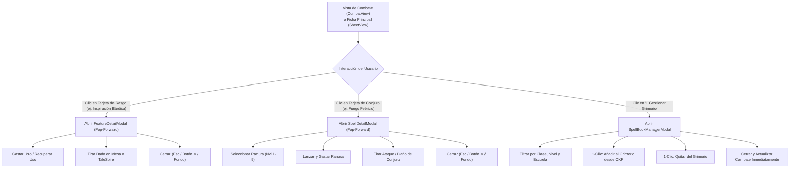

# Propuesta de Componentes y Experiencia de Usuario Frontend

**Documento:** `docs/frontend/frontend_proposal.md`  
**Estado:** `Propuesta Técnica & Especificación de Componentes`  
**Módulos:** `frontend/src/views/`, `frontend/src/components/`, `frontend/src/context/`

---

## 1. Resumen de la Propuesta

Esta propuesta detalla la implementación de tres componentes clave y su integración en las vistas de **Combate (`CombatView`)**, **Ficha Principal (`SheetView`)** y **Grimorio (`SpellsView`)**:

1. **`<FeatureDetailModal>` (Tarjeta Emergente de Rasgos y Dotes)**:
   - Proyección hacia adelante (elevación z-50 y animación suave de escala).
   - Renderizado del texto de la regla con soporte Markdown.
   - Panel de control de usos interactivo con botones de consumo/recuperación.
   - Botón directo de tirada cuando el rasgo involucra dados (ej. Inspiración Bárdica, Hojas Psíquicas).
2. **`<SpellDetailModal>` (Tarjeta Emergente de Conjuro Canónico)**:
   - Proyección con estética de pergamino arcano / panel oscuro obsidiana.
   - Desglose de componentes: Tiempo de lanzamiento, Alcance/Área, Componentes (V, S, M), Duración, Concentración, Ritual.
   - Selector de nivel de ranura para escalado (Upcasting).
   - Botones tácticos de combate: `[Lanzar Conjuro (-1 Ranura)]`, `[Tirar Ataque Mágico]`, `[Tirar Daño]`.
3. **`<SpellBookManagerModal>` (Gestor de Conjuros desde el Compendio OKF)**:
   - Buscador universal en tiempo real con debounce (<200ms).
   - Filtros instantáneos: Clase (Bardo, Mago, Clérigo, Druida, Hechicero, Brujo, Paladín, Explorador), Nivel (Trucos a Nivel 9) y Escuela.
   - Marcador visual de conjuros ya aprendidos/registrados en la ficha del personaje activo.
   - Inserción y remoción con un solo clic, sin formularios manuales repetitivos.
4. **Sintaxis de Tiradas TaleSpire (`TaleSpire Chat Roll Helper`)**:
   - Selector en el cajón de dados (`DiceTray`) y en cada tarjeta para copiar la fórmula con formato `!Nombre:XdY+Z` o enviarla directamente por el WebSocket / Named Pipe del puente.

---

## 2. Flujo de Navegación y Diagrama de Estados (UX)

---

## 3. Especificación Técnica de los Componentes

### 3.1 `<FeatureDetailModal />`
- **Props**:
  - `feature: FeatureItemData | null`
  - `isOpen: boolean`
  - `onClose: () => void`
  - `onSpendUse: () => void`
  - `onRecoverUse: () => void`
  - `onRollDice: (formula: string, label: string) => void`
- **Comportamiento**:
  - Detecta si el texto o nombre contiene una fórmula de dados (`d6`, `2d6`, `d8`, etc.). Si existe, renderiza un botón destacado en color oro (`bg-gold text-canvas`) para tirar el dado inmediatamente.
  - Indicador de recarga semántico:
    - *Descanso Corto*: etiqueta en azul cian.
    - *Descanso Largo*: etiqueta en violeta etéreo.
    - *Pasivo*: etiqueta atenuada.

### 3.2 `<SpellDetailModal />`
- **Props**:
  - `spell: SpellItemData | null`
  - `isOpen: boolean`
  - `availableSlots: Record<string, number>`
  - `spellStats?: SpellStatsData`
  - `onClose: () => void`
  - `onCast: (slotLevel: number) => void`
  - `onRollAttack: () => void`
  - `onRollDamage: (formula: string) => void`
  - `onTogglePrepared?: () => void`
- **Comportamiento**:
  - Si el conjuro es de nivel > 0, ofrece un selector de nivel de ranura (mínimo el nivel del conjuro, hasta la ranura más alta disponible).
  - Al pulsar *Lanzar*, consume la ranura en el contexto del personaje activo y notifica mediante Toast.

### 3.3 `<SpellBookManagerModal />`
- **Props**:
  - `isOpen: boolean`
  - `onClose: () => void`
  - `characterClass: string`
  - `characterLevel: number`
  - `currentSpells: SpellItemData[]`
  - `onAddSpell: (spell: SpellItemData) => void`
  - `onRemoveSpell: (spellName: string) => void`
- **Comportamiento**:
  - Pre-selecciona la clase del personaje activo (ej. Bardo) y el nivel máximo de conjuros que puede lanzar según sus ranuras actuales.
  - Muestra un badge "En Grimorio" para los conjuros ya aprendidos, permitiendo quitarlos con un botón en rojo atenuado.
  - Búsqueda instantánea en cliente/servidor sobre la base de datos OKF.

---

## 4. Adaptación a la Guía de Estilos y Paleta Obsidiana

- **Fondo del Modal**: `bg-card` con borde sutil `border-border-iron` y sombra profunda `shadow-2xl shadow-black/80`.
- **Efecto Backdrop**: `bg-canvas/80 backdrop-blur-sm`.
- **Botones de Acción**:
  - Primaria: `bg-gold hover:bg-gold-hover text-canvas font-semibold`.
  - Destructiva / Gasto: `bg-crimson hover:bg-crimson-hover text-white`.
  - Secundaria: `bg-surface border border-border-iron hover:border-gold text-main`.
- **Cumplimiento Anti-Iconos**: Títulos y etiquetas descriptivas limpias sin iconos decorativos superfluos.
